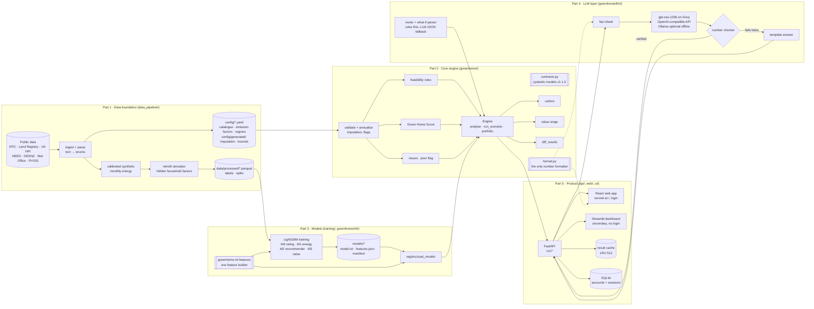
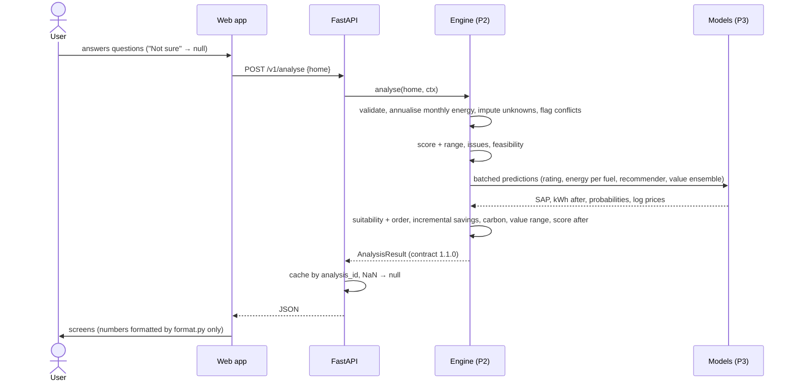
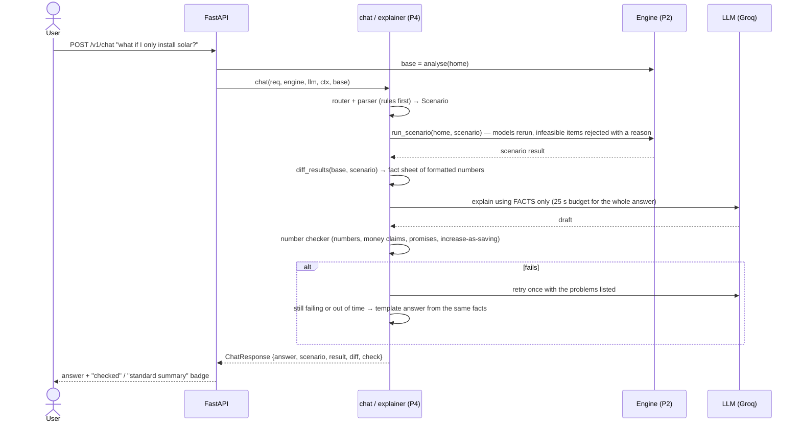
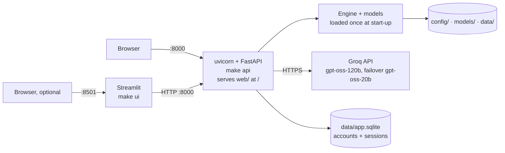

# Architecture

Green Home Score & Retrofit Engine (Megathon X, Problem Statement 2, Lloyds). This page describes the system
as built. A static image of the main diagram is in [`architecture.png`](architecture.png).

**Core rule:** every number comes from a documented model or formula. The language model only explains
numbers the engine has already computed, and a deterministic checker verifies every number it writes.

## 1. Components

| Layer | Owner | Code | What it does |
|---|---|---|---|
| Data | P1 | `data_pipeline/` | Downloads public data, parses EPC text into enums, joins Land Registry sales, generates calibrated monthly energy and simulator labels, writes splits and configs |
| Models | P3 | `training/`, `greenhome/ml/` | Trains four LightGBM models; `greenhome.ml.features` is the single feature builder for training and inference; `registry.load_models()` serves them |
| Engine | P2 | `greenhome/` | Contracts, validation and annualisation, score, issues, feasibility, ordering, savings, carbon, value range, scenarios, diffs; `format.py` is the only formatter |
| LLM | P4 | `greenhome/llm/`, `evaluation/` | Fact sheets, prompts, number checker, templates, router, what-if parser, chat, memory proposals, benchmark and evaluation |
| Product | P5 | `api/`, `web/`, `ui/`, `greenhome/labels.py` | HTTP API, accounts, the React web app (main UI), the Streamlit dashboard (secondary), shared plain-English labels, packaging |

## 2. Request flow: "analyse my home"

## 3. What-if and explanation flow

The LLM never sees a question without the recomputed results attached, and the app works with the LLM off:
explanations and chat then use the template answers.

## 4. HTTP API

| Method & path | Purpose |
|---|---|
| `POST /v1/auth/signup`, `/login`, `/logout`, `GET /v1/auth/me` | Accounts and login sessions (httpOnly cookie, SQLite) |
| `GET /v1/health` | Status, contract version, model mode (stub / real / fixture) and versions, live LLM check |
| `GET /v1/labels` | Plain-English labels for every enum, issue, reason and flag |
| `GET /v1/catalogue` | The demo homes as cards (name, score, class), scored once at start-up |
| `GET /v1/examples`, `GET /v1/examples/{id}` | Demo homes |
| `POST /v1/analyse` | Full analysis of a home |
| `POST /v1/scenario` | Analysis under a chosen set of retrofits or changed answers |
| `POST /v1/diff` | Code-computed comparison of two cached results |
| `POST /v1/explain` | Checked explanation of one section (score, recommendations, savings, value) |
| `POST /v1/chat` | What-if and explanation chat |
| `GET /v1/portfolio` | Homes ranked by improvement potential (precomputed) |
| `GET /v1/methodology` | Score weights, sub-score tables, catalogue and emission factors, read from config |

Errors are `{"error": {"code", "message"}}`; validation failures are 422. Responses never contain NaN.
With `GREENHOME_REQUIRE_AUTH=1` every `/v1` route except auth, health and labels needs a session (off by
default so the Streamlit dashboard, which has no login, keeps working).
Interactive documentation is served at `/docs`.

## 5. Shared contracts

| Contract | Where | Guards against |
|---|---|---|
| Pydantic models and enums (`extra="forbid"`) | `greenhome/contracts.py` | Misspelt enums, unknown fields, wrong units |
| One feature builder | `greenhome/ml/features.py` | Train/serve skew (models check their columns at load) |
| One state-change function | `greenhome/core/transitions.py::apply_retrofits` | Different "after retrofit" homes in simulator and app |
| One formatter | `greenhome/format.py` | The UI and the LLM showing different numbers for one fact |
| One label set | `greenhome/labels.py` | Screens and explanations wording codes differently |
| One split file | `data/processed/splits.parquet` (by customer) | Leakage between train, validation and test |

Units: kWh per year, kg CO2e per year, GBP. Savings are positive for a reduction; an increase is shown as an
increase. Missing values are `null`, never zero.

## 6. Deployment (demo)

Everything except the language model runs on one laptop, with no personal data. The LLM is a hosted
open-weight model on Groq; only the fact sheet of already-computed, formatted numbers and the user's question
are sent to it. Without a key (or with `LLM_PROVIDER=ollama` and a local model) the app still works. Models and
the LLM client are loaded once at start-up, never per request. The trained models are committed under `models/`
(compressed, 59 MB) and used by default (`config/global.yaml: models: real`); the test suite pins stand-in
models with `GREENHOME_MODELS=stub`, so tests don't depend on training.

## 7. Reproducibility

| Step | Command | Output |
|---|---|---|
| Install | `make setup` | `.venv` from the pinned `uv.lock` (Python 3.11) |
| Data | `make data-raw`, `make data` | `data/processed/`, `config/generated/` |
| Models | `make train` | `models/` |
| Evaluation | `make eval`, `make llm-bench` | `reports/` |
| Tests | `make test` | unit + integration tests |
| Run | `make api` (`make ui` optional) | Web app and API on :8000; Streamlit dashboard on :8501 |

Every script reads the seed (42) from `config/global.yaml`; LightGBM runs deterministically.
