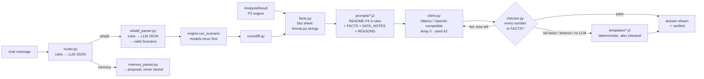

# LLM layer (Part 4)

Deliverable E: prompts, model and API details, guardrails, evaluation approach and results.
Code: `greenhome/llm/`. Config: `config/llm.yaml`. Evaluation: `evaluation/`. Build plan: `docs/ROADMAP_P4.md`.

## 1. What the LLM does, and what it never does

The Green Home Score, savings, carbon and value numbers all come from P2's engine and P3's models. The LLM
**only explains** them in plain English and turns what-if questions into scenarios. It never calculates,
scores or estimates a number.

Four guardrails enforce this:
1. **Fact sheet.** The model only sees pre-formatted numbers, the exact strings the screens show.
2. **Number checker.** Every number in every reply is checked against that fact sheet.
3. **One retry, then a template.** A failed check gets one retry with feedback, then a deterministic
   template answer built from the same facts. The user never sees an unchecked number.
4. **The LLM is never on the critical path.** With the LLM off, slow or failing, every endpoint still
   answers, from templates.



## 2. Model and runtime

| Item | Value |
|---|---|
| Runtime | Ollama ≥ 0.5 (JSON-schema structured output), local; any OpenAI-compatible endpoint as a fallback (README L5) |
| Model | **TODO_BENCH**: pinned in `config/llm.yaml` after `make llm-bench` on the demo laptop (RTX 4050 6 GB, 16 GB RAM) |
| Candidates | one 7–8B instruct model at 4-bit and one 3–4B instruct model (`config/llm.yaml: candidates`) |
| Determinism | `temperature 0`, `seed 42` on every request; identical requests are cached (in-memory LRU) |
| Context | `num_ctx 4096` (a fact sheet is ≤ ~600 tokens; system prompt + retry fit easily). The bench also tries 8192 |
| Output | `max_tokens` 300 for answers (the prompt asks for ≤ 170 words), 200 for JSON parses, 16 for routing |
| keep_alive | `"2h"` on **every** request, so the model isn't unloaded mid-demo |
| Warm-up | `make_client()` loads the model at API start-up in a background thread (same options as real calls) and logs if it isn't fully on the GPU |
| Time budget | **25 s per answer** for all LLM calls together (router + parser + answer + retry). Per-call caps: router 4 s, parse 6 s, answer 12 s. A retry starts only with ≥ `min_retry_s` left (8 s, TODO_BENCH). UI timeouts: 30 s |
| Cost | £0 (local model) |

Both providers are called over plain `httpx` streaming. Our own deadline stops reading mid-stream, and no
SDK retries in the background. A reply cut off at `max_tokens` is treated as a failure, never shown.

**Settings** (`config/llm.yaml`, environment variables override):

| Env var | Meaning |
|---|---|
| `LLM_PROVIDER` | `ollama` or `openai_compat`. **Env only**: unset means LLM off, so tests and unconfigured machines run on templates |
| `LLM_MODEL` | overrides the pinned model; leave empty to use the pin |
| `LLM_BASE_URL` | `http://localhost:11434` for Ollama; the `/v1` base URL for a hosted endpoint |
| `LLM_API_KEY` | hosted endpoint only; lives in `.env`, never committed |
| `LLM_TIMEOUT_S` | hard cap for one call (30) |
| `LLM_ANSWER_BUDGET_S` | budget for a whole answer (25) |

## 3. Interfaces (CR-7, used by P5's API)

```python
explain(result: AnalysisResult, section: "score"|"recommendations"|"savings"|"value", llm: LLMClient | None)
    -> tuple[str, CheckReport]          # never raises; LLM off/timeout → template, fallback_used=True
chat(req: ChatRequest, engine: Engine, llm: LLMClient | None, ctx: CustomerContext | None,
     base: AnalysisResult) -> ChatResponse   # stateless; multi-turn state = req.current_scenario
make_client() -> LLMClient | None       # None if not configured / unreachable / model not pulled
```

`CheckReport` always describes the text actually shown: `passed`, `numbers_found`, `unsupported`,
`banned_phrases`, `attempts` (LLM calls made), `fallback_used` (template). The UI badge is
"✓ all N numbers verified" (LLM answer) or "template answer".

| Chat intent | `scenario` | `result` | `diff` | `memory_proposal` |
|---|---|---|---|---|
| `whatif` | parsed scenario | `engine.run_scenario(...)` | `diff_results(base, result)` | — |
| `explain` | current scenario | base, or the current scenario's result | only for "why did it change?" | — |
| `memory` | current scenario | — | — | proposed events, **not stored** |
| `out_of_scope` / `unclear` | current scenario | — | — | — |

## 4. Prompts (`greenhome/llm/prompts/`)

| File | Used for |
|---|---|
| `_system.j2` | shared system prompt: README P4.3 core verbatim + FACTS, DATA_NOTES, REASONS, statuses |
| `explain_score.j2`, `explain_recommendations.j2`, `explain_savings.j2`, `explain_value.j2` | the task for each explain section |
| `whatif_answer.j2` | explaining a what-if result against the recommended plan |
| `whatif_parse.j2` | LLM fallback: message → `{"mode", "retrofits"}` (JSON schema; never numbers) |
| `memory_parse.j2` | LLM fallback: message → `{"events": [...]}` (budgets kept only if the user typed them) |
| `router.j2` | LLM fallback: message → one intent (JSON enum) |

The system prompt's rules (verbatim from README P4.3, a unit test checks they are present):
```
1. Use ONLY numbers that appear in FACTS, copied exactly as their "display" text.
   Never calculate, add, subtract, convert, round or estimate a number yourself.
2. If the user asks for something not in FACTS, say it isn't available from this tool.
3. Savings are "estimated". Property value changes are "indicative" and not guaranteed or causal.
4. If DATA_NOTES list missing, assumed or conflicting data, mention the ones that affect your answer.
5. Never recommend a retrofit marked infeasible. Explain its REASON instead.
6. If electricity use goes up while gas goes down, say so explicitly.
7. No financial or mortgage advice. Plain English, at most 170 words, no tables.
```

## 5. Fact sheet (`facts.py`)

The model sees each fact's label and display string. It never sees the raw value, so it can't copy an
unrounded number. Example, the savings sheet for the PS example home P10001 on stub models:
```
F7 All recommended retrofits · estimated saving · electricity: 1,240 kWh/year increase
F8 All recommended retrofits · estimated saving · gas: 11,130 kWh/year
F10 Improvement potential (share of today's bought energy saved): 58.8%
F15 All recommended retrofits · estimated carbon saving (tonnes): 1.9 t CO2e/year
```
- **Display strings come only from `greenhome/format.py`** (`fmt_kwh_saving`, `fmt_points`, `fmt_range`, …),
  so the chat and the screens print identical strings.
- **No arithmetic in P4.** Diff facts (what-ifs) come from P2's `core/diff.py`.
- **Statuses gate numbers.** An `insufficient` or `out_of_scope` section contributes no numbers, only the
  reason (e.g. the no-info home P90003, the off-gas home P90005).
- **Size.** One section is ≲ 2.4k characters (≈ 600 tokens). Incremental savings and infeasible-item details
  are added only for retrofits the user names.

## 6. Number checker (`checker.py`)

1. **Extract** every numeric mention: £350,000 · £350k · £1.2m · 2–5% · 2.5% – 3.5% · 5,500 kWh · 1.2 t ·
   36/100 · −2,950 · years · number words next to a unit ("two thousand kWh", "halves"). Digits inside words
   are ignored (`CO2e`, `F7`, `P10001`).
2. **Match** against the display numbers of the sheet's facts, numbers in the notes and reasons, and a few
   context-bound structural numbers (0, small counts not followed by a time unit, "/100", "12 months").
   Same unit class, tolerance `max(½ display step, 0.5 %)`.
3. **£ claims with no fact fail outright**: £-per-year bill savings and "adds £N to your value".
4. **Banned phrases, negation-aware.** "guarantee", "will increase your value", "certainly save",
   "exactly N", "financial advice", "you should remortgage" fail, but "indicative and not guaranteed" passes.
5. **Direction.** A number that is only ever an *increase* (e.g. a heat pump's extra electricity) fails when
   it is described as a saving.

| Reply | Result |
|---|---|
| "Gas falls by 11,130 kWh/year, but electricity use goes up by 1,240 kWh/year." | pass |
| "You would save 1,240 kWh/year of electricity." | fail (direction) |
| "You'd save around 12,500 kWh of gas." | fail (not in FACTS) |
| "That would save £400 a year on bills." | fail (no such figure) |
| "This is indicative and not guaranteed." | pass |

The templates go through the same checker in the tests. All 4 sections × 5 fixtures pass.

## 7. Router, what-if parser, memory

- **Router** (`router.py`), rules first in this order: hypotheticals ("what if", "suppose") → what-if;
  memory statements ("we installed", "our budget is", "we don't want") → memory; questions with a home-energy
  word → explain (section picked from the words); retrofit names with "only / without / add" → what-if; no
  domain word → out of scope; otherwise the LLM classifies (JSON enum) or the answer is "unclear".
- **What-if parser** (`whatif_parser.py`): synonyms → retrofit ids, then operators applied **left to right on
  one working list**, so follow-ups build on the current scenario (README §16 step 6: "only solar", then
  "and a heat pump but no loft insulation", gives `[solar_pv, air_source_heat_pump]`; the engine then caps the
  heat pump at low with `INSULATE_FIRST`). Overrides use only numbers the user typed ("if my gas was 9,000
  kWh"), built from the user's raw input so the other fuel's monthly readings survive. Every scenario is
  validated with Pydantic before the engine runs. A budget or "wall insulation" with an unknown wall type
  gets a clarifying question. Infeasible requests are passed on and P2's engine rejects them with a reason.
- **Memory** (`memory_parser.py`): "We installed loft insulation last year and we don't want a heat pump"
  becomes `completed_retrofit(loft_insulation)` + `exclude(air_source_heat_pump)`. P4 **never stores**
  anything: the UI asks the user to confirm and P5 stores it.

## 8. Evaluation

Run on the demo laptop: `make eval` (`python -m evaluation.eval_llm`). Without an LLM it exits with an error.
`--allow-no-llm` writes a clearly marked pipeline test (`reports/llm_eval_dryrun.md`) instead.

| Set | Size | What |
|---|---|---|
| `evaluation/llm_scenarios.jsonl` | 80 | 20 normal · 10 missing data · 10 conflicting signals · 10 infeasible requests · 10 heat pump · 8 insufficient info · 8 multi-turn what-if · 4 adversarial. Each item: home (fixture + overrides), turns, expected intent/scenario, `must_mention`, `must_not`. Built by `evaluation/build_llm_scenarios.py` |
| `evaluation/whatif_parse_gold.jsonl` | 50 | labelled utterances → expected `Scenario`; 44 for the rules, 6 left to the LLM fallback |
| Human annotation | 40 answers | stratified sample from the eval run, labelled claim by claim by P1 and P2 independently (`evaluation/annotation/RUBRIC.md`) |

**Metrics** (targets from README P4.6):
- **Numeric groundedness** (target ≥ 90%): % of answers with 0 unsupported numbers, **before** the checker
  (raw first LLM attempt) and **after** it (the answer shown).
- **Factual accuracy** (target ≥ 90%): % of numbers matching facts, plus `must_mention` satisfied.
- **Unsupported claim rate** (target < 5%): from the human annotation, with Cohen's κ.
- **Also:** `must_not` violations, intent and scenario accuracy, what-if parse accuracy (rules only vs
  rules + LLM), fallback rate by reason, latency median/p95, tokens per answer.

**Results: TODO_BENCH** (from `make eval` on the demo laptop, `reports/llm_eval.md`):

| Metric | Before checker | After checker | Target |
|---|---|---|---|
| Numeric groundedness | TODO_BENCH | TODO_BENCH | ≥ 90% |
| Factual accuracy | — | TODO_BENCH | ≥ 90% |
| Unsupported claim rate (human) | — | TODO_BENCH (κ = TODO_BENCH) | < 5% |
| What-if parse accuracy | rules only TODO_BENCH | rules + LLM TODO_BENCH | — |
| Latency median / p95 | — | TODO_BENCH | ≤ 25 s |

Pipeline test with templates only (dev machine, no LLM, stub models; this shows the pipeline works, not
model quality): the shown answers were 100% grounded, `must_mention` was 100% satisfied, there were 0
`must_not` violations, and intent accuracy was 100%. The rules alone parsed 46 of the 50 what-if items: all
44 rules items, plus the 2 LLM items whose expected answer is a clarifying question.

## 9. Limitations

- A small local model will make mistakes. The checker stops wrong numbers, not clumsy wording. A sentence
  with correct numbers can still be unhelpful, so the human annotation measures that separately.
- `must_mention` uses phrase patterns, so a correct answer worded differently counts as a miss.
- The direction check uses nearby cue words. An unusual phrasing can slip past it or be flagged wrongly
  (flagged answers fall back to the template, which is safe).
- Floor area has no shared formatter yet, so explanations leave it out.
- A custom what-if scenario skips P2's budget filter (`OVER_BUDGET` exists only in recommended mode).
- Results are reported for the stub models until P3's models are switched on. Explanations then follow
  the new numbers automatically, with no prompt changes.

## 10. Running it on the demo laptop

1. Install Ollama ≥ 0.5. For a 6 GB GPU, set `OLLAMA_NUM_PARALLEL=1`, `OLLAMA_FLASH_ATTENTION=1` and
   `OLLAMA_KV_CACHE_TYPE=q8_0`.
2. Pull each model in `config/llm.yaml: candidates` with `ollama pull <tag>`.
3. In `.env`, set `LLM_PROVIDER=ollama` and `LLM_BASE_URL=http://localhost:11434`. Leave `LLM_MODEL=` empty.
4. Run `uv run --env-file .env python -m evaluation.llm_bench`. Read `reports/llm_bench_<host>.md` and pin
   the recommended `model`, `num_ctx` and `min_retry_s`.
5. Run `uv run --env-file .env python -m evaluation.eval_llm`. This writes `reports/llm_eval.md` and the
   annotation pack (`evaluation/annotation/`).
6. Send P1 and P2 `MESSAGE.md`. When both sheets are back, run `uv run python -m evaluation.annotate score`
   to write `reports/llm_annotation.md`.
7. Run `make api`. `/v1/health` should show `llm_ok: true`.
