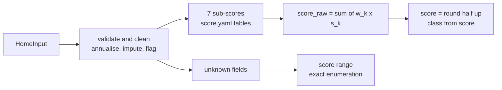

# Green Home Score: method and sub-score mappings

Deliverable D (documented sub-score mappings). Method version **`score-v1`** (`config/score.yaml`).
Every number here is read from `config/*.yaml` or the team guide. Values still marked `TODO_SOURCE` in config
are called **placeholder** below and are listed in [§12](#12-limitations-and-placeholders).

## 1. Summary

The Green Home Score is a number from 0 to 100 that says how energy-efficient and low-carbon a UK home is
today. It is a **deterministic weighted sum of seven documented sub-scores**: one rating lookup, one linear
mapping of metered energy per m², and five feature lookups. No machine-learning model and no LLM computes
the score. The same input always gives the same score, and every result carries `method_version: "score-v1"`
so an auditor can tie it back to this document. The engine keeps `score_raw` unrounded, rounds it once
(half up) to the integer `score`, and assigns the class from the rounded score. When answers are unknown, the
engine also reports a **score range** instead of hiding the uncertainty behind a single number.

Code: `greenhome/core/score.py` (`compute_score`, `insulation_sub_score`), rounding only in
`greenhome/format.py` (`round_score`).

## 2. Weights and classes

| Component | Key | Weight | Max contribution |
|---|---|---|---|
| Energy efficiency (EPC rating) | `energy_efficiency` | 0.25 | 25 |
| Consumption intensity | `consumption_intensity` | 0.20 | 20 |
| Insulation (roof + walls) | `insulation` | 0.15 | 15 |
| Heating system | `heating` | 0.15 | 15 |
| Glazing | `glazing` | 0.10 | 10 |
| Renewables | `renewables` | 0.10 | 10 |
| Smart controls | `smart_controls` | 0.05 | 5 |
| **Total** | | **1.00** | **100** |

The problem statement fixes these weights; we do not tune them.

`score_raw = Σ weight_k × sub_score_k`, and each `contribution_k = weight_k × sub_score_k` (unrounded, so the
contributions sum exactly to `score_raw`). `score = round_half_up(score_raw)`.

| Class | Rounded score | `score_class` |
|---|---|---|
| Highly efficient | 80–100 | `highly_efficient` |
| Good | 65–79 | `good` |
| Moderate | 50–64 | `moderate` |
| Poor | 30–49 | `poor` |
| Very poor | 0–29 | `very_poor` |

Classes use inclusive lower bounds on the **rounded** score. So `score_raw` 29.5 → 30 → Poor, and 79.5 → 80
→ Highly efficient; 29.49 stays Very poor. Rounding is half up via `Decimal`, so binary float error cannot
move a boundary. `is_poor` is true for `poor` and `very_poor`.

## 3. Sub-score mappings

### 3.1 Energy efficiency (EPC band)

**Basis:** midpoint of each band's SAP range (`config/engine.yaml: sap_bands`), with A anchored to 100.

| Band | SAP range | Midpoint | Sub-score |
|---|---|---|---|
| A | 92–100 | anchored | 100 |
| B | 81–91 | 86 | 86 |
| C | 69–80 | 74.5 | 75 |
| D | 55–68 | 61.5 | 62 |
| E | 39–54 | 46.5 | 47 |
| F | 21–38 | 29.5 | 30 |
| G | 1–20 | 10.5 | 10 |

Midpoints are rounded half up to whole points, except G: the team's frozen score table fixes G at 10 rather
than 11. The effect is at most 0.25 score points (1 point × weight 0.25), only for G-rated homes.

### 3.2 Consumption intensity

`I = purchased_kwh / floor_area_m2`, where `purchased_kwh = electricity_kwh (grid import) + gas_kwh`.

`s = 100 × clip((i_worst − I) / (i_worst − i_best), 0, 1)`

| Bound | Value | Meaning |
|---|---|---|
| `i_best` | 85 kWh/m²/yr | intensity at or below which `s = 100` |
| `i_worst` | 230 kWh/m²/yr | intensity at or above which `s = 0` |

**Basis:** the bounds are the train-split P5 and P95 of `purchased_kwh / floor_area_m2` (grid import + gas)
over 34,856 training homes, written by Part 1's pipeline (`data_pipeline/build_dataset.py`) to
`config/generated/intensity_bounds.yaml`. The span is 230 − 85 = 145 kWh/m², so each 1.45 kWh/m² of intensity
is one sub-score point. The mapping is linear and non-increasing in `I`, so using less energy never lowers the
score. Climate normalisation with `hdd_factor` is a stretch goal and is **not** applied in `score-v1`.

### 3.3 Insulation

`insulation = 0.4 × roof + 0.6 × wall`. When `roof_type = dwelling_above` (a flat or maisonette with a home
above), the roof is excluded and the wall takes the full weight: `insulation = wall`.

**Basis:** typical heat-loss shares of walls (~35%) and roof (~25%), renormalised to sum to 1
(35/60 ≈ 0.6, 25/60 ≈ 0.4). A home above loses almost no heat through its ceiling, so the roof term would
only add noise.

| Roof insulation | Roof sub-score |
|---|---|
| none | 0 |
| low | 35 |
| medium | 65 |
| full | 100 |

| Wall insulation | solid | cavity | timber_or_system |
|---|---|---|---|
| none | 0 | 20 | 30 |
| partial | 60 | 60 | 60 |
| full | 100 | 100 | 100 |

Uninsulated walls differ by construction: an unfilled cavity and a timber or system-built wall lose less
heat than a solid wall. Once insulated, the construction no longer changes the sub-score.

### 3.4 Heating, glazing, renewables, smart controls

| Heating system | Sub-score | | Glazing | Sub-score |
|---|---|---|---|---|
| heat_pump | 100 | | single | 0 |
| gas_boiler_condensing | 65 | | partial_double | 40 |
| gas_boiler_old | 35 | | secondary | 50 |
| other_fuel_boiler | 30 | | double | 80 |
| electric_storage | 25 | | triple | 100 |
| electric_direct | 10 | | | |

| Renewables | Sub-score | | Smart controls | Sub-score |
|---|---|---|---|---|
| none | 0 | | none | 0 |
| solar_thermal | 40 | | timer_only | 25 |
| solar_pv | 80 | | programmer_thermostat | 50 |
| solar_pv_battery | 100 | | programmer_thermostat_trvs | 65 |
| | | | smart_thermostat | 85 |
| | | | smart_zoned | 100 |

**Order bases** (the order matters; the exact spacing is a documented judgement):

- **Heating** follows the EPC/RdSAP element-efficiency rating each system typically receives, which reflects
  cost and carbon per useful kWh of heat.
- **Glazing** follows typical window U-values (heat loss per m² of window).
- **Renewables** follow the share of household energy each option offsets; a battery raises PV
  self-consumption.
- **Smart controls** follow the typical heating saving each control level gives.

## 4. Justifications

1. **Rating vs intensity overlap.** The EPC rating is the *modelled* efficiency of the building under
   standard occupancy. Intensity is *actual* metered use per m², which also reflects behaviour and occupancy.
   They can disagree, and the disagreement is informative: a rating A/B home using more than its peer P90, or
   an F/G home using less than its peer P10, raises `CONFLICT_RATING_VS_USAGE` (info). The problem statement
   prescribes both components, and we keep both.
2. **Feature components vs rating (double counting).** Insulation, heating, glazing, renewables and controls
   also feed the EPC rating. We keep them because they are **actionable** (each maps 1:1 to a retrofit) and
   the problem statement fixes their weights. The effective double count is bounded. Example: moving glazing
   from single to double adds 0.10 × (80 − 0) = **8.0 points** directly. The rating can change by at most one
   band step for this measure, worth 0.25 × (62 − 47) = 3.75 points for an E → D move, and never more than
   0.25 × 20 = 5.0 points (the largest adjacent gap, G → F).
3. **Solar counted twice.** Renewables credits *having* generation. Intensity uses purchased energy, which PV
   lowers by the self-consumed share of its output. The stub energy model computes the displaced grid import
   as `kWp(property type) × regional PV yield × mid self-consumption`, capped at grid import (catalogue
   `kwp_by_property_type`, `self_consumption_frac_range` 0.30–0.50; PVGIS yield from `config/regions.yaml`).
   For P10001 (semi-detached, East Midlands, 4,800 kWh electricity, 85 m²): 3.5 kWp × 979.6 kWh/kWp × 0.40 =
   **1,371 kWh**, the engine's standalone `solar_pv` saving. That is 8.2% of purchased energy; intensity drops
   by 16.1 kWh/m², which adds **2.2 points** via the intensity component (1.7–2.8 points across the 0.30–0.50
   self-consumption range), on top of the 8.0 points from the renewables component. The effect is documented,
   small and deliberate.
4. **Monotonicity.** Each lookup is ordered by quality, and the intensity mapping is linear and
   non-increasing, so improving any single input or lowering purchased energy never lowers the score.
   `tests/unit/p2/test_score.py` checks this: each lookup is monotone in its documented order (for every wall
   type); a Hypothesis property test (200 random homes) improves one quality-ordered field, or lowers gas
   use, and asserts `score_raw` does not drop; intensity is non-increasing and clipped to 0–100; weights sum
   to 1.0; contributions sum to `score_raw`; class boundaries 29.5 → 30 and 79.5 → 80; the score is
   reproducible.

## 5. Worked example: P10001

Semi-detached, 1950–1966, 85 m², rating E, 4,800 kWh electricity and 12,000 kWh gas per year.

| Component | Input | Sub-score | Weight | Contribution |
|---|---|---|---|---|
| Energy efficiency | E | 47 | 0.25 | 11.750 |
| Intensity | (4,800 + 12,000) / 85 = 197.6 kWh/m² | 100 × (230 − 197.6) / 145 = 22.31 | 0.20 | 4.462 |
| Insulation | loft low (35), cavity unfilled (20) → 0.4 × 35 + 0.6 × 20 | 26 | 0.15 | 3.900 |
| Heating | gas_boiler_condensing | 65 | 0.15 | 9.750 |
| Glazing | single | 0 | 0.10 | 0.000 |
| Renewables | none | 0 | 0.10 | 0.000 |
| Smart controls | programmer_thermostat | 50 | 0.05 | 2.500 |
| **Total** | | | | **32.362 → 32, Poor** |

The problem statement shows 38 for this home as an illustration; it does not publish sub-score mappings.
Our documented mappings give **32**, in the same class (Poor, 30–49). The difference comes from the mappings
we had to define, chiefly intensity: 197.6 kWh/m² lies close to the train-split P95 (230), so the home gets
only 22.31 of 100 intensity points, and each intensity sub-score point moves the total by 0.20. The golden
unit test reads the bounds from config and recomputes the expected sub-scores, so it follows the bounds.
All inputs are user-given, so the score range is 32–32.

## 6. Unknown answers and the score range

A field counts as unknown when its provenance is `imputed` or `assumed`. The engine fills it with a
best-guess value (for example the age-band × property-type mode), scores that value, and then reports a range:

1. For each unknown score feature field (`roof_type`, `roof_insulation`, `wall_type`, `wall_insulation`,
   `glazing`, `heating_system`, `renewables`, `smart_controls`), take **every** value of its enum.
2. If `energy_rating` was imputed by the rating model, take the imputed band **±1 band** (`rating_band_spread:
   1`), clipped to A–G.
3. Score **every combination exactly** (all other inputs fixed), round each total half up, and report
   `score_range = (min, max)`. Combinations that leave the insulation sub-score undefined are skipped.
4. Each affected component also gets `sub_score_range`.

The minimum-information rule (≤ 3 unknown feature fields) keeps this small: at most 6 × 6 × 5 feature values
× 3 rating bands = 540 combinations.

Example: P10001 with glazing unknown. The placeholder mode table imputes `double` (80), so the score is
32.362 + 8.0 = 40.362 → **40** (Poor), and glazing can be anything from single (0, total 32.362) to triple
(100, total 42.362), so the range is **32–42**.

Energy itself is not enumerated. If energy comes from typical homes, the result carries
`ENERGY_FROM_TYPICAL_HOMES` and the intensity component's provenance shows `imputed`.

## 7. Minimum-information policy

When a rule fails, the engine returns `status = insufficient` (or `out_of_scope`) with **no numbers**, plus a
warning flag. It never shows a number it cannot support.

- **Score** needs all of:
  - `floor_area_m2`, given or imputed from bedrooms;
  - a rating and annual energy (so all 7 sub-scores exist), of which **at least one is real**: a user-given
    rating, or energy that is not imputed from typical homes;
  - ≤ 3 unknown score feature fields (`min_info.max_unknown_feature_fields: 3`).

  Otherwise `insufficient` + `INSUFFICIENT_INFO_SCORE`.
- **Savings** need `main_fuel` electricity or mains gas (`in_savings_scope`), a known (not imputed)
  `heating_system`, and a baseline for both fuels: metered with coverage ≥ 0.5, or typical-home imputation
  (flagged). Otherwise `out_of_scope` (other fuels) or `insufficient` + `INSUFFICIENT_INFO_SAVINGS`.
- **Value** needs `current_value_gbp`, or region + property_type + floor area + age_band for a model
  estimate, plus an energy rating (given or imputed). Otherwise `insufficient` + `INSUFFICIENT_INFO_VALUE`.
- **Improvement potential** needs savings status `ok` and baseline purchased energy > 0. Otherwise `None`.

Improvement potential is a percentage of baseline purchased energy. With no baseline it has no denominator,
and a baseline of 0 would divide by zero, so the engine returns `None` rather than a misleading 0% or 100%.

## 8. Annualising monthly energy

Gas use is strongly seasonal, so mean × 12 underestimates a year with missing winter months. The engine
uses seasonal shares per fuel (`config/regions.yaml`, national profile if the region is unknown):

- Window: the latest **12** calendar months, ending at the latest month supplied.
- `coverage = Σ share[m]` over window months that have a reading. A missing month is **never** treated as 0.
- `annual = Σ readings / coverage`.

| Coverage | Result | Flag |
|---|---|---|
| ≥ 0.75 | annual from monthly | none |
| 0.5 to < 0.75 | annual from monthly | `LOW_COVERAGE_ANNUALISATION` (warning) |
| < 0.5 | `None` | `INSUFFICIENT_MONTHLY_DATA` (warning) |

**Conflict rule:** if the user also gives an annual figure and the monthly estimate differs from it by more
than **15%** of the annual figure, the engine raises `CONFLICT_ANNUAL_VS_MONTHLY` and uses the monthly
estimate when coverage ≥ 0.75, otherwise the annual figure.

**Example** (national gas shares, `config/regions.yaml: national.gas_monthly_share`). A home has gas
readings for March to November only, totalling 7,170.6 kWh. Coverage is the sum of the March–November shares:
0.12000 + 0.09615 + 0.06304 + 0.03729 + 0.02943 + 0.02991 + 0.04107 + 0.07103 + 0.10963 = **0.59755**, so
annual = 7,170.6 / 0.59755 = **12,000 kWh** with a `LOW_COVERAGE_ANNUALISATION` warning. Mean × 12 would give
7,170.6 / 9 × 12 = 9,560.8 kWh, 20% too low.

The shares come from Part 1's `data_pipeline/build_regions.py`: 75% space heating weighted by monthly
heating degree days (Hitchin formula, base 15.5 °C, Met Office HadUK-Grid 2016–2025) plus 25% hot water and
cooking weighted by days × (55 °C − mains water temperature). Electricity shares come from the Low Carbon
London smart-meter trial (UKPN, 2013).

## 9. Data quality flags and issues

### 9.1 Data quality flags (`validate.py`, `annualise.py`, orchestrator)

| Code | Condition | Severity |
|---|---|---|
| `MISSING_FIELD` | a feature field was not provided | info |
| `IMPUTED_FIELD` | value filled from a table, the rating model, or inferred | info |
| `LOW_COVERAGE_ANNUALISATION` | 0.5 ≤ coverage < 0.75 | warning |
| `INSUFFICIENT_MONTHLY_DATA` | monthly readings given but coverage < 0.5 | warning |
| `CONFLICT_ANNUAL_VS_MONTHLY` | monthly estimate differs from annual by > 15% | warning |
| `CONFLICT_HEATING_VS_GAS` | gas heating with gas < 2,000 kWh/yr, or electric heating with gas > 3,000 (1) | warning |
| `CONFLICT_RATING_VS_USAGE` | user rating A/B and intensity > peer P90, or F/G and < peer P10 (2) | info |
| `CONFLICT_AGE_VS_INSULATION` | age band `2007_onwards` and user says wall_insulation `none` | warning |
| `CONFLICT_ROOF_VS_TYPE` | `dwelling_above` on a house or bungalow → roof_type set to null, then imputed | error |
| `OUTLIER_AREA_PER_BEDROOM` | floor area per bedroom < 8 or > 150 m² | warning |
| `OUTLIER_INTENSITY` | intensity > 3 × peer P90 or < 10 kWh/m² (skipped if energy is imputed) | warning |
| `OUTLIER_VALUE` | value < £30,000 or > £10,000,000 | warning |
| `ENERGY_FROM_TYPICAL_HOMES` | annual energy imputed from the typical-home table | warning |
| `OUT_OF_SCOPE_FUEL` | `main_fuel = other` | warning |
| `INSUFFICIENT_INFO_SCORE` / `_SAVINGS` / `_VALUE` | [§7](#7-minimum-information-policy) rule fails | warning |

(1) Electric heating = heat_pump, electric_storage or electric_direct. Skipped when gas is imputed.

(2) Both values are kept and explained. Skipped when energy is imputed or the rating is not user-given.

Peer percentiles come from `config/generated/peer_percentiles.parquet` (train-split percentiles by property
type and floor-area band ≤50, 50–90, 90–130, 130–200, >200 m², upper edge inclusive). Part 1 commits that
file (`.gitignore` exempts it); if it is missing the engine falls back to `engine.yaml: peers_fallback`
(placeholder, by floor-area band only).

### 9.2 Issues and the poor flag (`issues.py`)

| Code | Rule | Severity |
|---|---|---|
| `HIGH_INTENSITY` | intensity > peer P90 → high; > peer P75 → medium (skipped if energy is imputed) | high / medium |
| `LOW_RATING` | rating E → medium; F or G → high | medium / high |
| `POOR_ROOF_INSULATION` | loft, flat or room-in-roof with insulation none → high; low → medium | high / medium |
| `POOR_WALL_INSULATION` | wall_insulation = none | high |
| `SINGLE_GLAZING` | single → high; partial_double → medium | high / medium |
| `OLD_HEATING` | gas_boiler_old, electric_direct, electric_storage or other_fuel_boiler | high |
| `NO_RENEWABLES` | renewables = none and solar_pv is `feasible` | medium |
| `NO_SMART_CONTROLS` | smart_controls none or timer_only | low |

Issues are sorted high → medium → low. Comparing intensity to a size-banded peer group means a large home is
not called inefficient just for being large.

## 10. Feasibility rules (`feasibility.py`)

Rules run in the order listed. The first matching *infeasible* rule wins; otherwise every matching
*needs_survey* rule adds its reason; otherwise the retrofit is *feasible*. Imputed or assumed inputs count as
unknown here, so a guessed value leads to a survey, not a firm recommendation. All 7 retrofits are always
returned, infeasible ones with their reason.

| Retrofit | Verdict | Condition | Reason |
|---|---|---|---|
| loft_insulation | infeasible | roof_type = dwelling_above | `NO_LOFT_DWELLING_ABOVE` |
| | infeasible | roof_type = flat_roof (a different measure) | `FLAT_ROOF_INSULATION_DIFFERENT_MEASURE` |
| | infeasible | roof_insulation = full | `ALREADY_INSTALLED` |
| | needs_survey | roof_type or roof_insulation unknown | `UNKNOWN_INPUT_SURVEY` |
| cavity_wall_insulation | infeasible | wall_type known and ≠ cavity | `WRONG_WALL_TYPE` |
| | infeasible | wall_insulation = full | `ALREADY_INSTALLED` |
| | needs_survey | wall_type or wall_insulation unknown | `UNKNOWN_INPUT_SURVEY` |
| solid_wall_insulation | infeasible | wall_type known and ≠ solid | `WRONG_WALL_TYPE` |
| | infeasible | wall_insulation = full | `ALREADY_INSTALLED` |
| | needs_survey | wall_type or wall_insulation unknown | `UNKNOWN_INPUT_SURVEY` |
| | needs_survey | listed or conservation area (internal insulation only) | `LISTED_OR_CONSERVATION` |
| double_glazing | infeasible | glazing double or triple | `ALREADY_INSTALLED` |
| | infeasible | listed or conservation area (secondary glazing suggested) | `LISTED_OR_CONSERVATION` |
| | needs_survey | glazing unknown | `UNKNOWN_INPUT_SURVEY` |
| air_source_heat_pump | infeasible | heating_system = heat_pump | `ALREADY_INSTALLED` |
| | needs_survey | heating_system unknown | `UNKNOWN_INPUT_SURVEY` |
| | needs_survey | flat or maisonette, or outdoor_space ≠ yes | `NEEDS_OUTDOOR_SPACE_CHECK` |
| solar_pv | infeasible | renewables solar_pv or solar_pv_battery | `ALREADY_INSTALLED` |
| | infeasible | roof_type = dwelling_above, or flat or maisonette | `NO_SUITABLE_ROOF` |
| | needs_survey | listed or conservation area | `LISTED_OR_CONSERVATION` |
| | needs_survey | roof_type or property_type unknown | `UNKNOWN_INPUT_SURVEY` |
| smart_thermostat | infeasible | smart_controls smart_thermostat or smart_zoned | `ALREADY_INSTALLED` |
| | infeasible | heating_system = electric_direct | `INCOMPATIBLE_HEATING` |
| | needs_survey | heating_system or smart_controls unknown | `UNKNOWN_INPUT_SURVEY` |

A heat pump on `main_fuel = other` stays allowed, with the extra reason `OUT_OF_SCOPE_FUEL` (savings are not
modelled). `INCOMPATIBLE_HEATING` is our addition: a smart thermostat cannot usefully control direct electric
panel heaters. Retrofits in the customer's `completed_retrofits` become infeasible with `ALREADY_INSTALLED`.

## 11. Suitability, ordering, savings, carbon and value

### 11.1 Suitability (`ordering.py`)

For each feasible or needs-survey retrofit `r` with a standalone saving from the energy model:

- `saving_share_r = net standalone saving / baseline purchased kWh`
- `cost_eff_r = net saving kWh per £1,000 of (cost midpoint − grant)`; free after grant counts as the best.
- `norm(x)` = x divided by the largest positive value among this home's candidates, clipped to 0–1.
- `u_r = w_p × p_assessor_r + w_save × norm(saving_share_r) + w_cost × norm(cost_eff_r)`

The customer's stated priority picks the weights (`score.yaml: suitability.priority_weights`). It changes
ranking and suitability only, never a kWh, carbon, score or value number.

| Priority | w_p | w_save | w_cost |
|---|---|---|---|
| balanced (default, BUILD_GUIDE) | 0.4 | 0.4 | 0.2 |
| carbon | 0.3 | 0.5 | 0.2 |
| bills | 0.3 | 0.3 | 0.4 |
| value | 0.4 | 0.4 | 0.2 |

`carbon` re-weights the net-kWh saving share; a true carbon share would differ only by the gap between the
electricity and gas emission factors. `value` equals balanced because there is no per-retrofit value model.

| Level | Rule |
|---|---|
| High | u ≥ 0.6 |
| Medium | 0.35 ≤ u < 0.6 |
| Low | u < 0.35 |
| Caps | needs_survey → at most Medium; prerequisite unmet → at most Low + `INSULATE_FIRST` |

The heat-pump prerequisite is an insulation sub-score ≥ 50 (unknown counts as below) or loft, cavity or solid
wall insulation in the same package. Thresholds are initial values; Part 3 tunes them on the validation split.

| Reason | Condition |
|---|---|
| `HIGH_SAVING` | saving_share ≥ 10% |
| `QUICK_WIN_LOW_COST` | top of cost range ≤ £1,500 and net saving > 0 |
| `HIGH_COST_LOW_SAVING` | cost midpoint ≥ £5,000 and saving_share < 3% |
| `ELECTRICITY_RISES_GAS_FALLS` | electricity saving, rounded to the 10 kWh display step, < 0 and gas saving > 0 (model noise that shows as "0 kWh/year" doesn't trigger it) |
| `ASSESSORS_OFTEN_RECOMMEND` | recommender probability ≥ 0.6 |
| `CUSTOMER_EXCLUDED`, `CUSTOMER_DECLINED_BEFORE`, `OVER_BUDGET` | from the customer context (below) |

**Customer context** (memory). The engine applies every rule, so the API and the chat agree:

| Context field | Effect | Reason code |
|---|---|---|
| completed retrofits | applied to the home before validation, so they read as installed | `ALREADY_INSTALLED` |
| excluded retrofits | left out of the package; still listed with no rank | `CUSTOMER_EXCLUDED` |
| declined retrofits | suitability one level lower (high → medium → low) | `CUSTOMER_DECLINED_BEFORE` |
| budget | greedy package by `u_r` within net cost (see 11.2) | `OVER_BUDGET` |
| priority | picks the suitability weights above | — |

### 11.2 Ordering and budget

The package is ordered by a stable topological sort over the catalogue: hard edges from `prerequisites`,
soft edges from `soft_after`, stages `fabric → glazing → controls → heating → generation`. Inside a stage,
higher `u_r` goes first, then catalogue order. With a budget, retrofits are kept greedily by `u_r` while the
cumulative net cost (cost midpoint − grant, floored at 0) fits; the rest get `OVER_BUDGET`.

### 11.3 Savings

`saving = baseline − after` per fuel; **positive = reduction**, and a negative electricity saving means
consumption rose (a heat pump moves load from gas to electricity). `net_kwh = electricity + gas`. Each
retrofit reports two numbers:

- **Standalone:** this measure alone on the current home.
- **Incremental:** the extra saving when added in the recommended order,
  `incremental_k = after(prefix_{k−1}) − after(prefix_k)`.

Incremental savings telescope, so they sum exactly to the package saving; the engine asserts this in code
and integration test IT3 checks it. Interactions show up here: loft insulation saves less after a heat pump.
Savings come from the energy model (M1; `stub-0` stubs until Part 3 ships trained models).

**Improvement potential** = `100 × (baseline purchased − purchased after the full feasible package) /
baseline purchased`. The full package is every feasible and needs-survey retrofit, as the problem statement
defines it, even when the customer excluded some or a scenario uses a smaller package. The portfolio view
ranks homes by this number.

### 11.4 Carbon (`carbon.py`)

`ΔC (kg CO2e/yr) = Δelectricity_kWh × EF_electricity + Δgas_kWh × EF_gas`

| Fuel | Factor (kg CO2e/kWh) | Basis | Source |
|---|---|---|---|
| electricity | 0.13096 | UK grid electricity generated, scope 2 location-based; excludes T&D losses | DESNZ 2026 |
| gas | 0.18231 | natural gas combustion, scope 1, gross calorific value (as billed); excludes WTT | DESNZ 2026 |

Source: DESNZ *Greenhouse gas reporting: conversion factors 2026*, flat file v1.2 (`config/emission_factors.yaml`
gives the DESNZ row IDs and URL). The T&D loss (0.01299) and well-to-tank (0.03021) factors are recorded in the
file for sensitivity checks but are not added to the headline carbon numbers.

The sign follows the saving: positive = emissions reduction. A heat pump's negative electricity term and
positive gas term are both kept, so the net carbon is honest.

### 11.5 Property value range (`value.py`)

1. `sap_before` = rating-model SAP clipped into the stated band's SAP range (or into 1–100 if no band).
   `sap_after = sap_before + (SAP(after) − SAP(before))`, clipped to 1–100; `rating_after = band(sap_after)`.
2. Per ensemble member, `d = log price(after, rating_after) − log price(before, rating_before)`;
   uplift % = `100 × (exp(d) − 1)`.
3. low / mid / high = **P10 / P50 / P90** across members, then widened to at least **±0.5 percentage points**
   around mid, so the range never looks more precise than the model is.
4. Base value = the user's value if given, else `exp(median log price before)`. Values = base × (1 + uplift).

Every value result carries `caveat_code: indicative_not_causal`. The model learns how sale prices vary with
EPC rating across similar homes; it does not prove that a retrofit causes that uplift.

## 12. Limitations and placeholders

Values still marked `TODO_SOURCE` in config (they make the engine run; do not cite them):

| File | Placeholder values |
|---|---|
| `config/engine.yaml` | `peers_fallback` intensity percentiles (by floor-area band only; used when no peer parquet) |

"Not sure" answers are filled from Part 1's `config/generated/imputation.yaml` (train split only): median floor
area by property type × bedrooms (unknown type → home-weighted mean over types); the most common feature value
for the age band × property type cell (either unknown → the value covering the most homes across matching
cells); typical energy from NEED 2024 medians for gas homes and calibrated synthetic medians by heating system
for electrically heated homes (nearest floor-area band when a band has fewer than 30 homes).

Now sourced (no longer placeholders): intensity bounds 85 / 230 (train-split P5/P95, 34,856 homes); emission
factors (DESNZ 2026); the retrofit catalogue (each entry has a `source` and a `source_status` of verified,
secondary or engineering; `engineering` entries are our documented assumptions); regional HDD factors,
monthly gas and electricity shares and PVGIS yields (`config/regions.yaml`; the national block gets
`hdd_factor` 1.0 and the mean regional PV yield and profile from the loader, `greenhome/config.py:
_complete_national`); and `as_of_date` "2026-07" (`config/global.yaml`).

Other limitations:

- **Flat retrofit costs.** `cost_gbp` is a flat indicative range for a typical semi-detached home. The
  catalogue's `cost_scales_with_floor_area` flag is deliberately **not** applied: no reference floor area is
  defined and the range already spans typical homes. Costs for much smaller or larger homes are therefore
  rougher than the range suggests.
- **Stub models.** Until Part 3 ships trained models, savings come from the `stub-0` energy model: fixed
  heating shares (70% of gas, 60% of electricity), catalogue effect midpoints for fabric, glazing and
  controls, a fixed SCOP of 3.0 for the heat pump (not the catalogue's `scop_range`), and for solar PV
  `kWp × regional yield × mid self-consumption`, capped at grid import. Stub numbers are illustrative.
- **Off-gas homes** (`main_fuel = other`: oil, LPG, solid fuel, community heating) are scored, but savings
  are `out_of_scope`; the formulas cover electricity and mains gas only. Coverage is England and Wales.
- The score range covers unknown feature fields and an imputed rating; it does not vary typical-home energy.
- Intensity is not climate-normalised (`hdd_factor` stretch goal), so homes in colder regions score slightly
  lower for the same fabric.
- Suitability thresholds (0.6 / 0.35 and the reason thresholds) await tuning on the validation split.
- Until `models: real` is set in `config/global.yaml`, savings, imputed ratings, assessor probabilities and
  value use the `stub-0` models; the score itself uses no model except the rating model for a missing rating.
