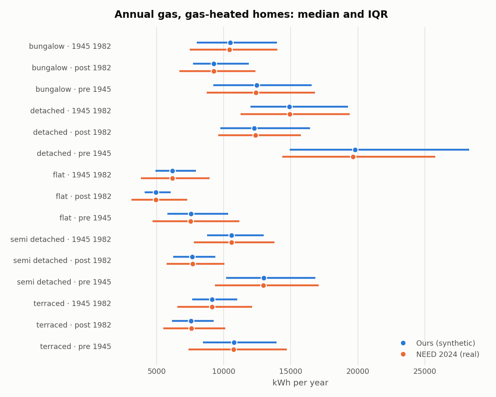
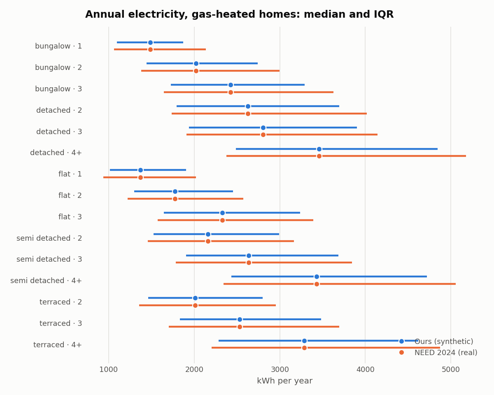
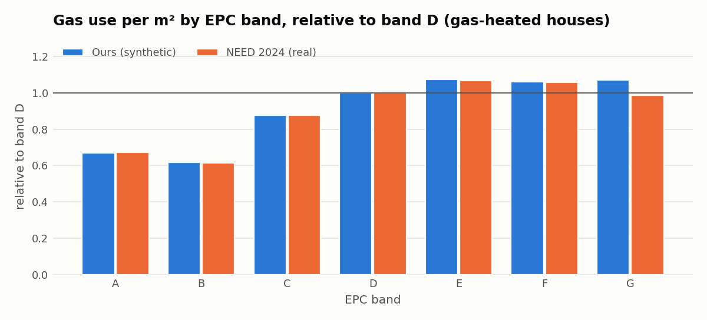
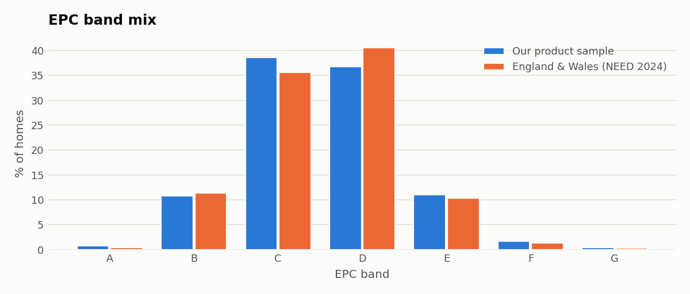
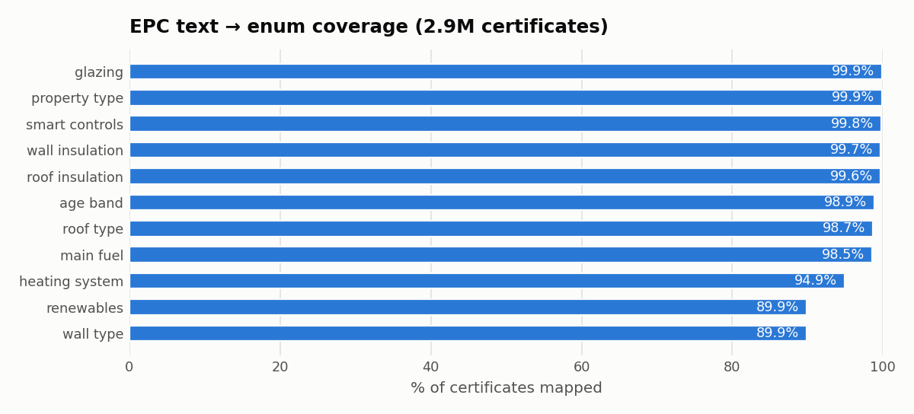
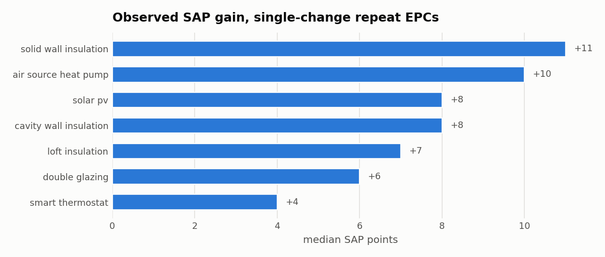

# Data quality report (Part 1)

Generated by `data_pipeline/data_report.py`. Each check compares our data with an independent real reference. Numbers behind every chart are in the table under it.

## Calibration: gas

Largest median error across cells: **0.8%**. Our inter-quartile range is **74%** of NEED's (median across cells): synthetic homes are a little more alike than real ones.

|                         |   sim_median |   gas_median |   sim_q25 |   gas_q25 |   sim_q75 |   gas_q75 |   n_sim |
|:------------------------|-------------:|-------------:|----------:|----------:|----------:|----------:|--------:|
| bungalow|1945_1982      |        10488 |        10428 |      7996 |      7475 |     13973 |     13998 |     827 |
| bungalow|post_1982      |         9263 |         9249 |      7710 |      6701 |     11890 |     12361 |     346 |
| bungalow|pre_1945       |        12447 |        12407 |      9225 |      8740 |     16549 |     16813 |     186 |
| detached|1945_1982      |        14881 |        14924 |     12009 |     11261 |     19257 |     19383 |     589 |
| detached|post_1982      |        12277 |        12364 |      9762 |      9587 |     16444 |     15746 |    1169 |
| detached|pre_1945       |        19778 |        19627 |     14930 |     14372 |     28293 |     25760 |     562 |
| flat|1945_1982          |         6182 |         6182 |      4924 |      3828 |      7919 |      8946 |    2403 |
| flat|post_1982          |         4954 |         4955 |      4106 |      3130 |      6063 |      7275 |    1749 |
| flat|pre_1945           |         7549 |         7540 |      5800 |      4710 |     10325 |     11176 |    3277 |
| semi_detached|1945_1982 |        10569 |        10574 |      8772 |      7779 |     12972 |     13785 |    2157 |
| semi_detached|post_1982 |         7664 |         7695 |      6250 |      5734 |      9371 |     10066 |    1307 |
| semi_detached|pre_1945  |        12972 |        12938 |     10196 |      9348 |     16826 |     17078 |    3454 |
| terraced|1945_1982      |         9137 |         9138 |      7652 |      6559 |     11027 |     12116 |    2429 |
| terraced|post_1982      |         7568 |         7590 |      6161 |      5504 |      9251 |     10116 |    1627 |
| terraced|pre_1945       |        10760 |        10736 |      8472 |      7374 |     13939 |     14708 |    5799 |

## Calibration: electricity

Largest median error across cells: **0.0%**. Our inter-quartile range is **84%** of NEED's (median across cells): synthetic homes are a little more alike than real ones.

|                  |   sim_median |   elec_median |   sim_q25 |   elec_q25 |   sim_q75 |   elec_q75 |   n_sim |
|:-----------------|-------------:|--------------:|----------:|-----------:|----------:|-----------:|--------:|
| bungalow|1       |         1488 |          1488 |      1095 |       1064 |      1870 |       2134 |     137 |
| bungalow|2       |         2022 |          2022 |      1442 |       1381 |      2742 |       2998 |     721 |
| bungalow|3       |         2423 |          2423 |      1725 |       1645 |      3291 |       3627 |     424 |
| detached|2       |         2627 |          2627 |      1793 |       1734 |      3696 |       4015 |     476 |
| detached|3       |         2803 |          2803 |      1937 |       1909 |      3901 |       4144 |     678 |
| detached|4+      |         3459 |          3459 |      2489 |       2378 |      4843 |       5177 |    1163 |
| flat|1           |         1372 |          1372 |      1013 |        939 |      1905 |       2018 |    2569 |
| flat|2           |         1777 |          1777 |      1297 |       1220 |      2453 |       2574 |    4124 |
| flat|3           |         2326 |          2326 |      1643 |       1574 |      3240 |       3391 |     670 |
| semi_detached|2  |         2158 |          2158 |      1523 |       1459 |      2992 |       3166 |    1444 |
| semi_detached|3  |         2634 |          2634 |      1904 |       1784 |      3684 |       3846 |    4740 |
| semi_detached|4+ |         3431 |          3431 |      2432 |       2341 |      4720 |       5056 |     726 |
| terraced|2       |         2009 |          2009 |      1463 |       1354 |      2800 |       2954 |    3406 |
| terraced|3       |         2531 |          2531 |      1832 |       1704 |      3484 |       3695 |    5486 |
| terraced|4+      |         3285 |          3285 |      2283 |       2204 |      4617 |       4876 |     884 |

## Performance gap: gas per m² by EPC band

Real homes (NEED) show a much flatter gradient across EPC bands than the ratings imply: F/G homes use no more gas per m² than D/E homes (the *prebound effect*: occupants of poorly rated homes heat less, and RdSAP overstates old-fabric heat loss). Without correction our physics model made F/G homes ~40-55% too hungry, which would overstate their retrofit savings. A per-band behaviour factor, fitted jointly with the type x age calibration, reproduces NEED's relative curve (chart). Absolute levels differ by ~15% because NEED's band table (houses, all tariffs) and its type x age table (standard tariff, used for the level) cover different populations. Band G has too few homes to fit and borrows band F's factor.

|    |   ours kWh/m² |   NEED kWh/m² |   ours vs D |   NEED vs D |   homes (ours) |
|:---|--------------:|--------------:|------------:|------------:|---------------:|
| A  |        86.112 |        74.276 |       0.669 |       0.673 |            171 |
| B  |        79.58  |        68     |       0.619 |       0.616 |           2309 |
| C  |       112.777 |        96.883 |       0.877 |       0.877 |           9582 |
| D  |       128.664 |       110.413 |       1     |       1     |          13388 |
| E  |       138.32  |       117.96  |       1.075 |       1.068 |           3528 |
| F  |       136.466 |       116.87  |       1.061 |       1.058 |            374 |
| G  |       137.89  |       108.904 |       1.072 |       0.986 |             20 |

## Representativeness: EPC band mix

|    |   ours |   England & Wales (NEED) |
|:---|-------:|-------------------------:|
| A  |    0.7 |                      0.4 |
| B  |   10.8 |                     11.4 |
| C  |   38.6 |                     35.6 |
| D  |   36.8 |                     40.6 |
| E  |   11   |                     10.4 |
| F  |    1.7 |                      1.4 |
| G  |    0.4 |                      0.3 |

## EPC parsing coverage

Unmapped values stay unknown (never guessed). Wall type and renewables gaps are new-build U-value-only and pre-2012 certificates; heating gaps are mostly community schemes (out of scope).

|                 |   coverage % |
|:----------------|-------------:|
| wall_type       |        89.87 |
| renewables      |        89.88 |
| heating_system  |        94.91 |
| main_fuel       |        98.53 |
| roof_type       |        98.69 |
| age_band        |        98.87 |
| roof_insulation |        99.65 |
| wall_insulation |        99.71 |
| smart_controls  |        99.8  |
| property_type   |        99.88 |
| glazing         |        99.92 |

## Real retrofit evidence (repeat EPCs)

Pairs where two or more elements got worse (assessor inconsistency) or floor area changed by over 15% were discarded.

| retrofit               |   events |   median_delta_sap |   share_sap_improved |   single_change_median_delta_sap |
|:-----------------------|---------:|-------------------:|---------------------:|---------------------------------:|
| smart_thermostat       |     5919 |                  9 |                 0.8  |                                4 |
| double_glazing         |    66791 |                  8 |                 0.79 |                                6 |
| loft_insulation        |   150341 |                  9 |                 0.83 |                                7 |
| cavity_wall_insulation |    65491 |                  9 |                 0.9  |                                8 |
| solar_pv               |    13253 |                 10 |                 0.76 |                                8 |
| air_source_heat_pump   |     3837 |                 16 |                 0.84 |                               10 |
| solid_wall_insulation  |    16493 |                 14 |                 0.94 |                               11 |

## Land Registry join

|                                |                0 |
|:-------------------------------|-----------------:|
| epc_properties                 |      1.84046e+06 |
| ppd_addresses_in_epc_postcodes | 598436           |
| matched_exact                  | 479078           |
| matched_fuzzy                  |  39058           |
| property_match_rate            |      0.2815      |
| sales_rows                     | 632980           |
| sales_with_rating_at_sale      | 617968           |

## Recommender labels vs feasibility rules

When our rules call a retrofit infeasible, assessors almost never recommend it (`recommended_when_rule_infeasible`), so the rules agree with real assessors.

| retrofit               |   feasible |   recommended |   recommended_given_feasible |   recommended_when_rule_infeasible |
|:-----------------------|-----------:|--------------:|-----------------------------:|-----------------------------------:|
| air_source_heat_pump   |     1      |        0.0004 |                       0.0004 |                                nan |
| cavity_wall_insulation |     0.8481 |        0.9555 |                       0.9475 |                                  1 |
| double_glazing         |     0.8657 |        0.8406 |                       0.8158 |                                  1 |
| loft_insulation        |     0.9848 |        0.4141 |                       0.405  |                                  1 |
| smart_thermostat       |     0.9991 |        0.2545 |                       0.2539 |                                  1 |
| solar_pv               |     0.9984 |        0.9665 |                       0.9665 |                                  1 |
| solid_wall_insulation  |     0.9238 |        0.9673 |                       0.9646 |                                  1 |
