# Part 5 Roadmap: Product (API · UI · Memory · Docs · Packaging)

> **Problem statement:** `LLOYDS-ps2.pdf` (full, cited here as "PS §n") and
> `PS2 Green Home Score - condensed.pptx.pdf` (slide summary). The PS wins over this file and the README;
> §2.1 maps every PS requirement that P5 touches to a task.
>
> **Companion to `README.md`.** The README is the source of truth for the whole build. This file covers
> **Part 5 only**: what it depends on, what depends on it, and the exact order of work.
> Where this file proposes something the README doesn't define, it's marked **CR-n** (change request) and
> needs Part 2's approval before the H+2 contract freeze.
>
> **Readers:** all five owners (to see what P5 needs from them and when) and coding agents (to run P5 tasks
> without guessing).

---

## Contents
1. [How to use this file](#1-how-to-use-this-file)
2. [Part 5 on one page](#2-part-5-on-one-page)
3. [How connected Part 5 is: coupling analysis](#3-how-connected-part-5-is)
4. [Change requests to the shared contract (decide by H+2)](#4-change-requests-to-the-shared-contract)
5. [P5-local schemas and conventions (binding for P5 code)](#5-p5-local-schemas-and-conventions)
6. [Task roadmap by phase](#6-task-roadmap-by-phase)
7. [Dependency ledger: inbound and outbound, with fallbacks](#7-dependency-ledger)
8. [Integration checkpoints: P5's role](#8-integration-checkpoints)
9. [Definition of done for Part 5](#9-definition-of-done-for-part-5)
10. [Hard rules for agents working on P5](#10-hard-rules-for-agents)
11. [Cut order if behind schedule](#11-cut-order)
12. [Decisions made in this file and open items](#12-decisions-and-open-items)

---

## 1. How to use this file

- **Times** use the README's convention: `H+N` = N hours after kick-off. "Pre" = before the event.
- **Task IDs** are `P5-NN`. Dependencies on other parts use the README's IDs (`D1`…`D16`, §13.2) and
  checkpoints (`I0`…`I4`, §13.3).
- Every task has:
  - **Needs**: task IDs or deliverables that must exist first
  - **Makes**: exact files
  - **Steps**
  - **Done when**: a check you can verify, usually a command
  - **If blocked**: the fallback to use when an input is late
- An agent picking up a task MUST (a) check that every item under **Needs** exists, (b) use the **If blocked**
  path if one doesn't, and (c) never edit a file owned by another part (README §6). Instead, write the
  request in the task's PR description and ping that owner.
- README section references look like `§7.3`. CRs in §4 below, once approved, become part of `contracts.py`
  and override the README.

---

## 2. Part 5 on one page

**Mission:** turn the engine (P2) and LLM layer (P4) into a working product, and package the whole repo so a
stranger can run it. P5 is the **integration sink**, the **repo/packaging owner** and the **submission
captain**.

| P5 owns | Files | Deliverable(s) |
|---|---|---|
| Repo skeleton, env, build | `pyproject.toml`, `uv.lock`, `Makefile`, `.env.example`, ruff/pytest config, folder tree | B |
| HTTP API | `api/*` | A |
| Streamlit UI | `ui/*` | A |
| Customer memory (STRETCH) | `greenhome/memory/*` | innovation (5%) |
| Architecture diagram | `docs/ARCHITECTURE.md`, `docs/architecture.png` | F |
| Responsible AI note | `docs/RESPONSIBLE_AI.md` | H |
| Run instructions | `docs/RUN.md`, README run section | B |
| Submission + demo | §15 checklist, §16 demo | all |

**What P5 never does:** compute numbers. Every score, saving, carbon figure, value and difference comes
from the engine (P2/P3) or from P2-owned code. P5 *formats* numbers only via `greenhome/format.py` (P2).

**Judging weight P5 affects directly:** UX 5%, Architecture/reproducibility 10%, Explainability & RAI 5%,
Innovation 5%, Business relevance 10% (portfolio view). Indirectly, it affects everything: judges only see the
other 70% through P5's UI and docs.

### 2.1 PS requirements → P5 tasks (traceability)
| PS ref | Requirement (paraphrased from the PS) | P5 task(s) | How P5 shows it |
|---|---|---|---|
| §1 | Answers "how green / what to improve / how much saved / value?" | P5-10…16 | Screens 2, 4, 5, 6 |
| §1, §8 | LLM only explains; what-if reruns models first, then LLM explains | P5-17, 18, 19 | Toggles call `/v1/scenario`; chat always attaches recomputed result + diff; checker badge |
| §2 | Show why a property got its score, including each component's contribution | P5-11 | Contributions bar + methodology expander |
| §2 | Final score rounded to integer for reporting/classification | P5-11 | `fmt_score` on `score` (engine-rounded); never re-round `score_raw` |
| §3 | Flag Poor/Very poor and list key issues | P5-12, 20 | Banner + issues list; portfolio `poor_only` filter |
| §3 | Rank properties by improvement potential; report unavailable when baseline is 0/missing | P5-20, 14 | Portfolio table; "unavailable" text when `improvement_potential_pct` is `None` |
| §3 | Large house not inefficient just for size | P5-12 | Peer gauge (size-banded peers, CR-3) |
| §4 | Prioritised feasible list, each with suitability, saving, reason; order reflects interactions | P5-13 | Ranked cards, chips, reasons, "do after …" |
| §5 | Per retrofit + package, kWh/yr, per fuel; increase shown as negative saving; "estimates, not guarantees" | P5-13, 14 | `fmt_kwh_saving` (red "increase"); caption on every chart |
| §6 | Carbon per fuel with documented EF, units, source | P5-14 | Tonnes + EF source footnote |
| §7 | Value as a range, "indicative", not causal | P5-16 | Range bar + caveat |
| §9 | No real personal/confidential customer data | P5-23, 27 | Memory holds only user-entered statements for synthetic customer ids; no address input |
| §9 | Distinguish baseline value estimate from historical sale prices | P5-16 | Value screen labels base value source |
| §10 | Memory: completed retrofits, constraints **or preferences**, past recommendations + responses; adapt later recommendations; scores still from models; **show how recommendations change** | P5-23, 24, CR-1, CR-6 | Memory panel, "then vs now" view |
| §11 | Scenario tests: missing/conflicting data, infeasible/interacting retrofits, higher electricity after heating change, too little info | P5-34 | Scenario walkthrough (§9 DoD) |
| §11 | Organisers may rerun code | P5-28, 31 | `docs/RUN.md` + clean-machine test |
| §11 | System performance: responsiveness, reliability, LLM cost | P5-05, 22, 21 | Timing middleware, p95 target, About page shows P4 latency/cost |
| §13 A, B, F, H | Prototype; code + run instructions; architecture diagram; RAI note | P5-01, 28, 26, 27 | — |

---

## 3. How connected Part 5 is

### 3.1 Verdict
Part 5 is the **most connected part by number of interfaces**: it touches all four other parts, plus every
deliverable. Its coupling is mostly **inbound and late** (it consumes finished outputs), with **three
outbound couplings that are early and blocking**. People tend to miss those three.

### 3.2 Coupling map

```mermaid
flowchart LR
  subgraph IN[Inbound to P5]
    P2C[P2 contracts.py · format.py\nH+2]:::hard
    P2F[P2 fixtures\nH+3]:::hard
    P2E[P2 Engine stub→real\nH+8 → H+18]:::hard
    P4X[P4 explainer + templates\nH+10]:::soft
    P4C[P4 chat + parser\nH+16]:::soft
    P1X[P1 examples\nH+10 → H+16]:::soft
    P1G[P1 peer percentiles\nH+14]:::soft
    REP[P1/P3/P4 reports + test preds\nH+26]:::soft
    DOC[All: doc sections\nH+28]:::soft
  end
  P5((PART 5))
  subgraph OUT[Outbound from P5]
    REPO[Repo · pyproject · uv.lock · Makefile\nH+0 → blocks EVERYONE]:::hard
    MEM[CustomerContext into Engine\nH+22 → P2 orchestrator]:::soft
    MK[Make targets call P1/P3/P4 entrypoints\nH+2 naming → H+28 make all]:::soft
    QA[I1, I4, RUN.md clean-machine test,\nsubmission packaging]:::soft
    REQ[UI requirements → contract CRs\nH+0–2 → P2/P4]:::hard
  end
  IN --> P5 --> OUT
  classDef hard fill:#fde2e2,stroke:#c0392b
  classDef soft fill:#e8f4fd,stroke:#2980b9
```


Red = blocking (work stops without it). Blue = degradable (a documented fallback exists).

### 3.3 Inbound: what P5 depends on

| From | What | README ref | Coupling | Effect on P5 if late or wrong |
|---|---|---|---|---|
| P2 | `contracts.py` (all request/response models, enums) | D1, §7.3 | **Hard, total** | Every route and every UI parse depends on it. A field rename breaks the API and UI at once. |
| P2 | `format.py` | §7.1 | **Hard** | Without it the UI can't display any number without breaking the "never compute or round" rule. |
| P2 | `AnalysisResult` fixtures | D2 | Hard until H+8 | P5 builds every screen against these until the real engine exists. |
| P2 | `Engine.from_config / analyse / run_scenario / portfolio` | D7, §7.7 | Hard | The API is a thin wrapper around these three calls. |
| P2 | Flag codes, reason codes, issue codes | P2.2, P2.6, P2.7 | Medium | The UI maps each code to text and colour. A new code without a label shows as the raw code. |
| P3 | Real models (via P2) | D12 | Indirect | Nothing changes in P5 code. Numbers change, so screenshots and the demo script must be redone after H+18. |
| P3 | Metrics, test predictions | D15 | Soft | Needed only for the About page, the RAI note and the demo's closing slide. |
| P4 | `explainer` (checker + templates) | D8 | Soft | `/v1/explain` returns 503 `explanation_unavailable`; the UI shows "explanation pending". |
| P4 | `chat` (router, parser, what-if answers, memory extraction) | D11 | Soft | Chat is disabled; scenario toggles still give what-if (§16 step 6 still demoable). |
| P1 | Demo examples `data/examples/*.json` + `index.json` | D9 | Soft | Fall back to P2's fixture homes. |
| P1 | `config/generated/peer_percentiles.parquet` (through P2, see CR-3) | D10 | Soft | Peer gauge hidden. |
| P1, P3, P4 | Docs sections and reports | D15, D16 | Soft but **deliverable-critical** | Deliverables F/G/H/I incomplete. P5 chases these from H+22. |

### 3.4 Outbound: how P5 affects the other parts

| To | What P5 provides or imposes | When | Why it matters |
|---|---|---|---|
| **Everyone** | Repo, `pyproject.toml`, `uv.lock`, folder tree, branches, Makefile, `.env.example` | **H+0 (ideally Pre)** | Nobody can `uv sync`, import `greenhome` or open a PR until this exists. P2 needs the repo to write contracts during H0–2, so a slow P5 delays the contract freeze. |
| **Everyone** | Dependency policy: new packages go through P5, who re-locks | H+0 onward | Unmanaged `uv add` from five laptops breaks `uv.lock` merges. |
| **P2** | UI-driven contract requirements (CR-1…CR-8) | **H+0–2** | The UI needs fields the README contract doesn't have (diff, peer percentiles, memory proposals, portfolio rows). Adding them after the freeze costs a version bump and fixture regeneration for P4 and P5. |
| **P2** | `CustomerContext` from memory → `engine.analyse(home, ctx)` | H+22 (D14) | P2's orchestrator must implement the exclusion, decline, budget and completed-retrofit semantics defined in CR-6. If P5 and P2 disagree on them, memory silently does nothing. |
| **P2** | Integration tests (co-owned) | H+14–20 | P5 adds the HTTP-level checks (NaN-free JSON, status codes, timing). |
| **P4** | `ChatRequest` assembly, chat history and session handling, memory-confirmation UX | H+16 | P4's chat is stateless per call (CR-7). P5 holds history and `current_scenario`, so multi-turn what-if works only if P5 passes them correctly. |
| **P4** | Display strings: P5 and P4 both use `format.py` | always | If the UI formatted numbers differently from the fact sheet, users would see two values for one fact. |
| **P1, P3, P4** | Make target names they must implement (§5.6) | agree by H+2, working by H+28 | `make all` (deliverable B) only works if every part exposes the agreed entrypoint. |
| **All** | Doc templates + deadlines; clean-machine test (I4) | H+22–32 | P5 is the last gate before submission. |

### 3.5 Blast radius summary
- **If P5 slips at H0–2**, the whole team slips (no repo, no lockfile, no contracts home).
- **If P5 slips mid-event (H8–20)**, others keep working. Only the demo and I1/I2 are at risk.
- **If P5 slips at H+28–32**, submission is at risk (deliverables A, B, F, H and the clean-machine run).
- **If any other part slips**, P5 degrades gracefully *only if* the fallbacks in §7 are built in from the
  start. They are part of the tasks below, not extras.

---

## 4. Change requests to the shared contract

**Process:** P5 sends CR-1…CR-8 to P2 at **H+0–1**. P2 accepts, edits or rejects each one by **H+2** and folds
the accepted ones into `contracts.py` v1.0.0, so no version bump is needed. Each CR below gives exact code.
If P2 rejects a CR, the matching **If rejected** line says what P5 does instead.

### CR-1 Memory events in `contracts.py` + memory proposal on `ChatResponse`
**Gap:** README P4.5 says P4 extracts a memory delta and the UI asks the user to confirm it. But
`ChatResponse` has no field to carry the delta, and the event schema lives only inside P5's SQLite table.
P4 needs to produce the type, so it must live in the shared contract.
```python
# greenhome/contracts.py  (additions; also add `Annotated` to the `typing` import)
class CompletedRetrofitPayload(Strict):
    kind: Literal["completed_retrofit"] = "completed_retrofit"
    retrofit: Retrofit
    completed_on: str | None = Field(default=None, pattern=r"^\d{4}-\d{2}$")

class ExcludeConstraintPayload(Strict):
    kind: Literal["exclude"] = "exclude"
    retrofit: Retrofit

class BudgetConstraintPayload(Strict):
    kind: Literal["budget"] = "budget"
    max_budget_gbp: float = Field(gt=0)

class PreferencePayload(Strict):
    kind: Literal["preference"] = "preference"
    priority: Literal["carbon", "bills", "value", "balanced"]

class RecommendationShownPayload(Strict):
    kind: Literal["recommendation_shown"] = "recommendation_shown"
    analysis_id: str
    ranked_retrofits: list[Retrofit]          # feasible ones, in rank order, as shown

class ResponsePayload(Strict):
    kind: Literal["response"] = "response"
    retrofit: Retrofit
    response: Literal["accepted", "declined"]

MemoryPayload = Annotated[
    CompletedRetrofitPayload | ExcludeConstraintPayload | BudgetConstraintPayload
    | PreferencePayload | RecommendationShownPayload | ResponsePayload,
    Field(discriminator="kind")]

class MemoryEventIn(Strict):
    payload: MemoryPayload

class MemoryEvent(Strict):
    id: int
    customer_id: str
    ts: str                                    # ISO 8601 UTC, e.g. 2026-10-10T14:03:00Z
    payload: MemoryPayload

# ChatResponse gains:
    memory_proposal: list[MemoryEventIn] | None = None   # set only when intent == "memory"
```
The SQLite `type` column stores `payload.kind`, mapped: `completed_retrofit` → `completed_retrofit`;
`exclude`, `budget` → `constraint`; `preference` → `preference`; `recommendation_shown` →
`recommendation_shown`; `response` → `response`. This keeps the README P5.4 table definition valid.
**If rejected:** memory proposals from chat are dropped. Memory is entered only through the Memory panel form.

### CR-2 `ResultDiff`, computed by P2 code
**Gap:** the what-if answer shows a "result diff table" (P5.3 screen 7) and the score card shows "36 → 61".
The UI may not subtract (P5 hazard 1). P4's facts already need diff facts "computed by code" (P4.2).
One P2 function should serve both.
```python
# greenhome/contracts.py
class DiffRow(Strict):
    key: Literal["score", "score_class", "electricity_kwh", "gas_kwh", "net_kwh",
                 "improvement_potential_pct", "carbon_total_kg", "value_uplift_pct_mid",
                 "rating_after", "sap_after"]
    unit: Literal["score", "class", "kwh_per_year", "pct", "kg_per_year", "rating", "sap"]
    base: float | str | None
    new: float | str | None
    delta: float | None                    # new − base for numeric keys; None for class/rating or if either is None

class ResultDiff(Strict):
    base_analysis_id: str
    new_analysis_id: str
    rows: list[DiffRow]                    # always all 10 keys, in the order above
    retrofits_added: list[Retrofit]        # in new.savings.retrofits but not in base
    retrofits_removed: list[Retrofit]
```
- `electricity_kwh`, `gas_kwh` and `net_kwh` rows compare **`savings.saving`**, keeping the README's sign
  convention (positive = reduction).
- P2 implements `greenhome/core/diff.py: diff_results(base: AnalysisResult, new: AnalysisResult) -> ResultDiff`.
- P4's `facts.py` builds diff facts from it. `ChatResponse` gains `diff: ResultDiff | None = None`.
- P5 adds `POST /v1/diff` (§5.2).

**If rejected:** the UI shows base and scenario values side by side with no delta column.

### CR-3 Peer comparison on `AnalysisResult`
**Gap:** screen 3's gauge ("You use X kWh/m²; similar-sized semis use Y") needs peer percentiles. The engine
reads `peer_percentiles.parquet` (P2.6 issues) but doesn't expose the values.
```python
class PeerComparison(Strict):
    intensity_kwh_m2: float
    property_type: PropertyType
    floor_area_band: Literal["lt_50", "50_90", "90_130", "130_200", "gt_200"]
    p50_kwh_m2: float
    p75_kwh_m2: float
    p90_kwh_m2: float
# AnalysisResult gains:
    peer: PeerComparison | None = None      # None if intensity or peer group unavailable
```
**If rejected:** the UI reads `evidence` from the `HIGH_INTENSITY` issue when present and hides the gauge
otherwise.

### CR-4 Typed portfolio rows + precomputed portfolio
**Gap:** `engine.portfolio()` returns `list[dict]`, so its columns are undefined. Computing it live is also too
slow. The test split is ~4.5k–9k homes, and at the README's 500 ms per `analyse()` that's 40–75 minutes.
```python
class PortfolioRow(Strict):
    rank: int                               # 1 = highest improvement potential
    property_id: str
    customer_id: str
    region: Region | None
    property_type: PropertyType | None
    score: int | None
    score_class: ScoreClass | None
    is_poor: bool | None
    improvement_potential_pct: float | None # rows with None sort last
    key_issues: list[str]                   # up to 3 issue codes, high → low severity
    savings_status: Literal["ok", "insufficient", "out_of_scope"]

class PortfolioResponse(Strict):
    split: Literal["train", "val", "test"]
    generated_at: str
    model_versions: dict[str, str]
    total: int
    rows: list[PortfolioRow]
```
- `engine.portfolio(split, limit)` returns `list[PortfolioRow]`.
- P5 adds `make portfolio`, which runs `uv run python -m api.build_portfolio --split test` and writes
  `outputs/portfolio/portfolio_test.json` (a `PortfolioResponse`).
- `GET /v1/portfolio` serves that file, filtered and limited. It never computes live.
- `make all` runs `portfolio` after `train`.

**If rejected:** P5 maps the dicts to `PortfolioRow` in the API layer, and asks P2 for the column names
in writing.

### CR-5 `analysis_id` must include the customer context
**Gap:** README §7.3 hashes "canonical input + scenario + model versions". With memory, the same home can
give different results for different contexts, so P5's LRU cache would return stale results.
**Change:** `analysis_id = sha256(canonical(home) + canonical(scenario) + canonical(ctx or null) + model_versions + CONTRACT_VERSION)`.
**If rejected:** the API cache key becomes `(analysis_id, sha256(ctx))`. This is P5-local but duplicates logic.

### CR-6 Memory semantics live in the engine, not in P5
**Gap:** README P5.4 has `context.py` applying completed retrofits to the home, while P2.8 step 6 has the engine
handling exclusions and budget. Splitting the job like that invites drift. **Decision:** P5 folds events into
a `CustomerContext`, and that's all it does. `engine.analyse(home, ctx)` applies **every** ctx rule:

| ctx field | Engine behaviour (P2) | Reason code |
|---|---|---|
| `completed_retrofits` | `home = apply_retrofits(home, completed)` **before** validation. Those retrofits are then `ALREADY_INSTALLED` | `ALREADY_INSTALLED` |
| `excluded_retrofits` | Removed from the package and from ranking. Still listed in `recommendations` with rank `None` | `CUSTOMER_EXCLUDED` |
| `declined_retrofits` | Suitability demoted one level (high→medium→low; low stays low) | `CUSTOMER_DECLINED_BEFORE` |
| `max_budget_gbp` | Greedy by `u_r` using `cost_high_gbp`. Items that don't fit are left out of the package | `OVER_BUDGET` |
| `priority` | Selects the suitability weights `(w_p, w_save, w_cost)` in `u_r = w_p·p_r + w_save·norm(save_r) + w_cost·norm(cost_eff_r)` (README P2.8 step 3) from `config/score.yaml → priority_weights`. Proposed: `balanced: [0.4, 0.4, 0.2]` (= README default); `carbon: [0.3, 0.5, 0.2]` with `save_r` = standalone **carbon** saving share instead of net kWh share; `bills: [0.3, 0.3, 0.4]`; `value: [0.4, 0.4, 0.2]` (= balanced, as there is no per-retrofit value model; documented). Changes ranking/suitability only, never a number | — (the UI states the active priority) |

Improvement potential still uses the full feasible package minus completed retrofits (README P2.8 step 6).
**Folding rules (P5, `greenhome/memory/context.py`):** process events by `(ts, id)` ascending.
`completed_retrofit` → add to `completed_retrofits` and remove from `declined_retrofits`. `exclude` → add to
`excluded_retrofits`. `budget` → latest wins. `preference` → latest wins. `response: declined` → add to
`declined_retrofits`. `response: accepted` → remove from `declined_retrofits`. `recommendation_shown` → no ctx
effect (used only for the "then vs now" view). Lists are deduplicated and kept in retrofit-enum order.
**If rejected:** P5 applies completed retrofits in `context.py` (via P2's `apply_retrofits`), and the engine
handles the rest.

### CR-7 P4 function signatures that P5 calls
P4 owns these modules. P5 needs fixed signatures to build against at H+3.
```python
# greenhome/llm/explainer.py
Section = Literal["score", "recommendations", "savings", "value"]
def explain(result: AnalysisResult, section: Section, llm: LLMClient | None) -> tuple[str, CheckReport]:
    """Never raises for LLM failures: llm None/timeout → template text, CheckReport.fallback_used = True."""

# greenhome/llm/chat.py
def chat(req: ChatRequest, engine: Engine, llm: LLMClient | None,
         ctx: CustomerContext | None, base: AnalysisResult) -> ChatResponse:
    """Stateless. `base` = engine.analyse(req.home, ctx), computed by the API and passed in.
    Multi-turn state = req.current_scenario only; P5 keeps the transcript."""

# greenhome/llm/client.py
def make_client() -> LLMClient | None:   # None if LLM_PROVIDER unset/unreachable at start-up
```
**If rejected:** P4 publishes its actual signatures by H+3, and P5 adapts `api/deps.py` only.

### CR-8 `format.py` functions P5 needs
P2 owns the names. P5 needs at least these, matching the README §7.1 rounding rules:
`fmt_kwh(x)`, `fmt_kwh_saving(x)` (negative → "… increase"), `fmt_kg(x)`, `fmt_tonnes(kg)`,
`fmt_gbp_value(x)`, `fmt_gbp_cost(x)`, `fmt_pct(x)`, `fmt_score(x)`, `fmt_sap(x)`, `fmt_range(lo, hi, fn)`,
`fmt_delta(x, unit)` (always signed, e.g. "+16"). Each takes `None` and returns `"—"`.
**If rejected:** P5 uses whatever P2 ships, and never writes a fallback formatter.

---

## 5. P5-local schemas and conventions

These are owned by P5 and don't need P2 approval. They live in `api/schemas.py` and are binding for P5 code.

### 5.1 Request/response models (`api/schemas.py`)
```python
class AnalyseRequest(Strict):     home: HomeInput;  customer_id: str | None = None
class ScenarioRequest(Strict):    home: HomeInput;  scenario: Scenario;  customer_id: str | None = None
class ExplainRequest(Strict):     analysis_id: str; section: Literal["score","recommendations","savings","value"]
class ExplainResponse(Strict):    text: str;        check: CheckReport
class DiffRequest(Strict):        base_analysis_id: str; new_analysis_id: str
class ExampleIndexItem(Strict):   property_id: str; title: str; why_interesting: str
class HealthResponse(Strict):
    status: Literal["ok", "degraded"]          # degraded = stub models or LLM down
    contract_version: str
    model_versions: dict[str, str]
    models_mode: Literal["stub", "real", "fixture"]
    llm_ok: bool
class MethodologyResponse(Strict):
    contract_version: str
    score_method_version: str
    weights: dict[str, float]
    classes: list[dict]                        # verbatim from score.yaml
    sub_score_tables: dict[str, Any]           # energy_efficiency, insulation, heating, glazing, renewables, smart_controls
    intensity_bounds: dict[str, float]         # {i_best, i_worst}
    retrofit_catalogue: list[dict]             # verbatim from retrofit_catalogue.yaml
    emission_factors: list[dict]               # verbatim from emission_factors.yaml
    model_versions: dict[str, str]
class MemoryResponse(Strict):
    customer_id: str; events: list[MemoryEvent]; context: CustomerContext
class ErrorBody(Strict):          code: str; message: str
class ErrorResponse(Strict):      error: ErrorBody
```
All values in `MethodologyResponse` are read through `greenhome.config`, never re-typed.

### 5.2 Routes (final list; extends README §7.8)
| Method & path | Body → Response | Behaviour |
|---|---|---|
| GET `/v1/health` | → `HealthResponse` | Never fails. Checks the LLM with a ≤ 2 s ping |
| GET `/v1/examples` | → `list[ExampleIndexItem]` | From `data/examples/index.json`; falls back to `tests/fixtures/home_input_*.json` |
| GET `/v1/examples/{property_id}` | → `HomeInput` | 404 `example_not_found` |
| POST `/v1/analyse` | `AnalyseRequest` → `AnalysisResult` | Loads ctx if `customer_id` is given; caches the result |
| POST `/v1/scenario` | `ScenarioRequest` → `AnalysisResult` | Same, via `run_scenario` |
| POST `/v1/diff` | `DiffRequest` → `ResultDiff` (CR-2) | Both ids must be in the cache, else 404 `analysis_not_found` |
| POST `/v1/explain` | `ExplainRequest` → `ExplainResponse` | 404 `analysis_not_found` on a cache miss. LLM down → template (still 200) |
| POST `/v1/chat` | `ChatRequest` → `ChatResponse` | API computes `base`, loads ctx, calls P4 `chat` |
| GET `/v1/portfolio?split=test&limit=50&poor_only=false` | → `PortfolioResponse` | Served from the precomputed file (CR-4); `limit` 1–500 |
| GET `/v1/methodology` | → `MethodologyResponse` | |
| GET `/v1/customers/{customer_id}/memory` | → `MemoryResponse` | Unknown customer → empty events + default context (not 404) |
| POST `/v1/customers/{customer_id}/memory` | `MemoryEventIn` → `MemoryEvent` | 422 if the payload is invalid |
| DELETE `/v1/customers/{customer_id}/memory` | → `{deleted: int}` | Resets the demo customer |

### 5.3 Error codes (HTTP status → `error.code`)
| Status | Code | When |
|---|---|---|
| 422 | `validation_error` | Pydantic failure (message = first error's `loc: msg`) |
| 404 | `analysis_not_found` | Explain or diff cache miss. **The UI re-POSTs `/v1/analyse`, then retries once** |
| 404 | `example_not_found` | Unknown example id |
| 503 | `engine_not_ready` | `Engine.from_config()` failed at start-up |
| 503 | `explanation_unavailable` | P4 module missing or not importable (before D8). Never sent for "LLM down" |
| 503 | `diff_unavailable` | `greenhome.core.diff` not yet delivered (CR-2) |
| 503 | `portfolio_not_built` | `outputs/portfolio/portfolio_test.json` missing |
| 500 | `internal_error` | Anything else; logged with a request id |

### 5.4 Engine and LLM wiring modes (`api/deps.py`)
`GREENHOME_ENGINE_MODE` = `fixture | engine` (default `engine`). Model choice (`stub` vs `real`) stays with P2's
`config/global.yaml: models`.
- `fixture`: a `FixtureEngine` with the same three methods. It returns `tests/fixtures/analysis_result_*.json`,
  chosen by `home.property_id`, and defaults to P10001. It sets `models_mode = "fixture"`. This lets P5 work
  from H+3 without P2's engine (README P5 hazard 5).
- `engine`: `Engine.from_config()`, called **once** in the FastAPI `lifespan`.
- The LLM client is created once with `make_client()`. `None` is allowed and means templates only.

### 5.5 Caching
`api/cache.py`: an in-process LRU of `analysis_id → AnalysisResult`, `maxsize=512`. Single uvicorn worker
(documented). No disk cache.

### 5.6 Make targets and the entrypoints other parts must provide
P5 writes the Makefile. Each owner MUST make their module runnable under this exact name by **H+14** (stub
`main()` that prints "TODO" is fine before then).

| Target | Command | Entrypoint owner |
|---|---|---|
| `setup` | `uv sync && mkdir -p data/raw data/interim data/processed models outputs reports` | P5 |
| `data-raw` | `uv run python -m data_pipeline.download.verify` | P1 |
| `data` | `uv run python -m data_pipeline.build_all` | P1 |
| `train` | `uv run python -m training.train_all` | P3 |
| `portfolio` | `uv run python -m api.build_portfolio --split test` | P5 (calls P2 `engine.portfolio`) |
| `eval` | `uv run python -m evaluation.eval_ml && uv run python -m evaluation.eval_llm` | P3, P4 |
| `test` | `uv run pytest -q` | all |
| `api` | `uv run uvicorn api.main:app --port 8000` | P5 |
| `ui` | `uv run streamlit run ui/app.py` | P5 |
| `all` | `data train portfolio eval test` (in that order) | P5 |
| `api-fixture` | `GREENHOME_ENGINE_MODE=fixture uv run uvicorn api.main:app --port 8000` | P5 |

### 5.7 UI conventions
- Multipage Streamlit: `ui/app.py` (sets the page config and initialises session state) plus `ui/pages/NN_<name>.py`,
  one file per screen. Shared widgets go in `ui/components/`. All HTTP calls go through `ui/api_client.py`
  (httpx, base URL `GREENHOME_API_URL`, timeout 60 s for chat and 15 s otherwise).
- `st.session_state` keys (exact): `home_input: dict | None`, `analysis: dict | None`, `base_analysis: dict | None`,
  `scenario: dict | None`, `scenario_analysis: dict | None`, `chat_history: list[dict]`, `customer_id: str | None`,
  `pending_memory: list[dict] | None`.
- `ui/labels.py`: `LABELS: dict[str, dict[str, str]]` = enum name → member → plain English, plus
  `FLAG_TEXT`, `REASON_TEXT`, `ISSUE_TEXT`, `CLASS_COLOUR`, `FUEL_COLOUR` (electricity `#1f77b4`,
  gas `#ff7f0e`, increase `#d62728`). The "Not sure" choice maps to `None`.
- Colours: class `highly_efficient #1a9850`, `good #91cf60`, `moderate #fee08b`, `poor #fc8d59`,
  `very_poor #d73027`.
- Every chart that shows savings, carbon or value has the caption "Estimates, not guarantees."
  The value chart also says "Indicative, not causal."

---

## 6. Task roadmap by phase

Legend: ⛔ = blocks another part · ⭐ = STRETCH (cuttable, §11).

### Phase 0: Pre-event / H+0 to H+2: skeleton and contracts input

**P5-01 ⛔ Repo skeleton** (Pre or H+0 to H+0.5)
- Needs: nothing.
- Makes: GitHub repo; `pyproject.toml` (README §5.2 deps, Python `==3.11.*`); `uv.lock`; `.env.example`
  (README §5.4 + `GREENHOME_ENGINE_MODE=engine`, `GREENHOME_MEMORY_DB=data/memory.sqlite`); `.gitignore`
  (`data/raw`, `data/interim`, `.env`, `data/memory.sqlite`, `__pycache__`); `ruff.toml`; `pytest.ini`
  (`testpaths = tests`); the full README §6 tree with `__init__.py` in every package (`greenhome`,
  `greenhome/core`, `greenhome/ml`, `greenhome/llm`, `greenhome/memory`, `api`, `api/routes`); `Makefile`
  (§5.6, with targets that don't exist yet echoing `TODO <owner>`).
- Steps: `uv init --package` → write the files → `uv lock` → push `main` → create branches `p1/main`…`p5/main`
  → protect `main` (PR required).
- Done when: on a second machine, `git clone && make setup && uv run python -c "import greenhome, api"` succeeds.
- If blocked: nothing upstream.

**P5-02 ⛔ Dependency policy** (H+0)
- Makes: a "Dependencies" section in `docs/RUN.md`. Only P5 runs `uv add`/`uv lock`. Others ask in the
  team channel with the package and reason, and P5 re-locks within 30 minutes. Versions are pinned exactly
  after the first `uv lock`.
- Done when: posted in the team channel.

**P5-03 ⛔ Send CR-1…CR-8 to P2** (H+0 to H+1)
- Needs: P5-01.
- Makes: one PR to P2's branch titled `CR: P5 contract additions`, with §4's code pasted into the
  description (P5 doesn't edit `contracts.py` directly).
- Done when: P2 has marked each CR accepted, edited or rejected, by H+2. Record the outcomes in §12 of this file.

**P5-04 Agree entrypoint names** (H+0 to H+2)
- Makes: §5.6 posted to the team. P1, P3 and P4 each confirm their module names.
- Done when: every row in §5.6 has a confirmed owner.

**P5-05 API shell** (H+1 to H+2)
- Needs: P5-01.
- Makes: `api/main.py` (FastAPI app, lifespan, request-timing middleware logging `method path status ms`),
  `api/json.py` (`NaNSafeJSONResponse`: recursively converts float NaN/±Inf to `None`, used as
  `default_response_class`), `api/errors.py` (exception handlers → §5.3 envelope), `api/routes/health.py`.
- Done when: `make api` → `curl localhost:8000/v1/health` returns 200 JSON (models_mode may be `"fixture"`).

**P5-06 UI shell** (H+1 to H+2)
- Needs: P5-01.
- Makes: `ui/app.py`, `ui/api_client.py`, empty `ui/pages/01_Your_home.py` … `09_About.py`, session-state
  init (§5.7), a health badge in the sidebar.
- Done when: `make ui` shows 9 pages and the sidebar health badge shows the API state.

### Phase 1: H+2 to H+10: build on fixtures → walking skeleton (I1)

**P5-07 `ui/labels.py` + test** (H+2 to H+4)
- Needs: D1 (`contracts.py`).
- Makes: `ui/labels.py`, `tests/unit/p5/test_labels.py`.
- Steps: one entry per member of every §7.2 enum. Flag, reason and issue texts come from README P2.2, P2.6 and
  P2.7. The test iterates over every Enum in `greenhome.contracts` and asserts each member has a label.
  It also asserts every flag, reason and issue code listed in the README tables has a text.
- Done when: `uv run pytest tests/unit/p5/test_labels.py` passes.

**P5-08 Fixture engine + deps** (H+3)
- Needs: D2 (fixtures).
- Makes: `api/deps.py` (§5.4), `api/cache.py` (§5.5).
- Done when: with `GREENHOME_ENGINE_MODE=fixture`, `get_engine().analyse(HomeInput())` returns the P10001
  fixture as an `AnalysisResult`.

**P5-09 Core routes** (H+3 to H+6)
- Needs: P5-05, P5-08.
- Makes: `api/routes/{examples,analyse,scenario,diff,explain,methodology}.py`, `api/schemas.py` (§5.1).
- Steps: implement §5.2 for these routes. `/v1/explain` imports `greenhome.llm.explainer` lazily and returns
  503 `explanation_unavailable` if the import fails. `/v1/diff` returns 503 `diff_unavailable` until
  `greenhome.core.diff` exists (CR-2).
- Done when: `tests/unit/p5/test_routes.py` (fastapi TestClient, fixture mode) covers every route: one happy
  path + one error path each, and asserts no `NaN` in any response body.

**P5-10 Screen 1: Your home** (H+3 to H+7)
- Needs: P5-06, P5-07.
- Makes: `ui/pages/01_Your_home.py`, `ui/components/home_form.py`.
- Steps: grouped form (Property · Features · Energy). Every select = enum members + "Not sure" (→ `None`).
  Plain-language options as in README P5.3 screen 1. Energy: radio "Annual totals" / "Monthly readings";
  monthly uses `st.data_editor` with columns `month (YYYY-MM)`, `electricity_kwh`, `gas_kwh`, and empty cells
  are sent as `null`. Include a "Load example home" select (from `/v1/examples`). Submit → `POST /v1/analyse`
  → store in `analysis` and `base_analysis` → show a flags panel (chips coloured by severity, with the
  `message` text) and a provenance legend (user / example / imputed / assumed / derived).
- Done when: loading P10001 and submitting shows its flags panel. Building `HomeInput` from the form
  produces no `""`, `"unknown"` or `0` for unset fields (unit test on the form → dict function).

**P5-11 Screen 2: Score** (H+5 to H+8)
- Needs: P5-10, CR-8 (`format.py`).
- Makes: `ui/pages/02_Score.py`, `ui/components/charts.py` (`contributions_bar(result)`).
- Steps: big `fmt_score(score)` + class chip in the class colour. If `score_range` is set: "could be lo–hi
  because N answers are unknown" (N = count of `MISSING_FIELD` flags). Plotly horizontal bar of the 7
  `contribution` values, labelled `weight × sub_score` (shown with `fmt_pct`/1 dp, values straight from the
  API). "How is this computed?" expander from `/v1/methodology`. A "Score after recommended package" card shows
  `score` → `score_after.score`, with the delta from `/v1/diff` once available (else no delta).
  `status == insufficient` → show the `INSUFFICIENT_INFO_SCORE` message and no number.
- Done when: P10001 renders its score and class, and the chart has 7 bars.

**P5-12 Screen 3: Problem areas** (H+6 to H+8)
- Makes: `ui/pages/03_Problem_areas.py`.
- Steps: Poor/Very poor banner if `is_poor`. Issues sorted high → medium → low, with `ISSUE_TEXT` + `message`.
  Peer gauge from `result.peer` (CR-3), hidden if `None`.
- Done when: P10001 shows SINGLE_GLAZING, POOR_WALL_INSULATION and POOR_ROOF_INSULATION.

**P5-13 Screen 4: Recommendations** (H+6 to H+9)
- Makes: `ui/pages/04_Recommendations.py`, `ui/components/reco_card.py`.
- Steps: cards for `rank is not None`, sorted by rank. Each shows the suitability chip, reason texts
  (`REASON_TEXT`), standalone and incremental savings **per fuel** via `fmt_kwh_saving` (negative → red,
  "increase"), cost range `fmt_gbp_cost(low)`–`fmt_gbp_cost(high)`, and "do after …" from `depends_on`.
  An expander "Not suitable for your home" lists `rank is None` items with their reasons.
- Done when: the P10001 heat-pump card shows electricity as a red "increase".

**P5-14 Screen 5: Savings & carbon** (H+7 to H+10)
- Makes: `ui/pages/05_Savings.py`.
- Steps: grouped bars baseline vs after (electricity, gas) from `savings.baseline` / `savings.after`; net
  saving; `improvement_potential_pct`; carbon via `fmt_tonnes(carbon.total_kg)` with a footnote
  `carbon.ef_source`. `status` `insufficient` / `out_of_scope` → message, no charts.
- Done when: P10001 renders, and the out-of-scope fixture (if P2 provides one) shows the message.

**P5-15 ⛔ Run checkpoint I1** (H+10)
- Needs: P5-09…P5-14, D7 (Engine on stubs), D8 (templates).
- Steps: switch `GREENHOME_ENGINE_MODE=engine`. Walk P10001 through screens 1–5 and call `/v1/explain` for
  all 4 sections. Log every failure as an issue assigned to an owner.
- Done when: every screen renders real stub-engine output, and explain returns template text with
  `check.fallback_used` set correctly.
- If blocked: if D7 is late, run I1 in fixture mode and record "engine pending".

### Phase 2: H+10 to H+18: full feature set

**P5-16 Screen 6: Property value** (H+10 to H+12)
- Makes: `ui/pages/06_Value.py`.
- Steps: range bar `value_low_gbp`–`value_high_gbp` over `current_value_gbp` (all `fmt_gbp_value`).
  Rating `rating_before` → `rating_after`. Uplift `fmt_pct` low/mid/high. Caveat text for `caveat_code`.
  Base value source (`user` → "your estimate", `model` → "model estimate").
- Done when: P10001 shows E → C (stub or real) and the caveat.

**P5-17 Screen 7a: Scenario toggles** (H+11 to H+14)
- Makes: `ui/pages/07_What_if.py` (toggle section), `ui/components/diff_table.py`.
- Steps: one checkbox per recommendation with `feasibility != infeasible`, all checked by default.
  "Run scenario" → `POST /v1/scenario` with `{mode: "custom", retrofits: [checked]}` (or `mode: "none"` if none
  are checked) → store `scenario_analysis` → `POST /v1/diff` → render `ResultDiff` rows (base, new, signed
  delta via `fmt_delta`) + `retrofits_added/removed`. Show `rejected` items with their reasons.
- Done when: unchecking everything except `solar_pv` on P10001 changes only electricity in the diff.
- **This is the what-if fallback when the LLM is down. Never cut it.**

**P5-18 Chat route** (H+14 to H+16)
- Needs: D11 (`greenhome.llm.chat`), CR-7.
- Makes: `api/routes/chat.py`.
- Steps: load ctx (memory, if `customer_id` is set) → `base = engine.analyse(req.home, ctx)` (cached) →
  `resp = chat(req, engine, llm, ctx, base)` → cache `resp.result` if present → return. If the P4 import
  fails → 503 `explanation_unavailable`.
- Done when: a TestClient test with a monkeypatched `chat` returns a valid `ChatResponse`.

**P5-19 Screen 7b: Chat** (H+15 to H+18)
- Makes: chat section of `ui/pages/07_What_if.py`.
- Steps: `st.chat_input`. Send `ChatRequest{session_id, home, message, current_scenario: session.scenario,
  customer_id}`. Append the user and assistant turns to `chat_history`. Under each answer show
  `resp.diff` (diff_table) and a checker badge: `check.fallback_used` → "template answer", otherwise
  "✓ all {len(check.numbers_found)} numbers verified". If `resp.scenario` is set, store it in `scenario`
  (multi-turn). If `resp.memory_proposal` is set, store it in `pending_memory` and show a confirm/discard box
  (handled by P5-24).
- Done when: "What if I only install solar?" on P10001 shows an answer, a diff and a badge. With the LLM
  stopped, the answer is still shown, with the template badge.

**P5-20 Portfolio** (H+14 to H+17)
- Needs: CR-4, D7.
- Makes: `api/build_portfolio.py`, `api/routes/portfolio.py`, `ui/pages/08_Portfolio.py`.
- Steps: the builder calls `engine.portfolio(split, limit=None)` and writes the `PortfolioResponse` JSON. The
  route serves it with the `poor_only` filter and `limit`. The UI shows a table (rank, property, type, region,
  score, class chip, IP %, key issues as text), a "Poor/Very poor only" toggle, and a "Load this home" button
  per row (`/v1/examples/{id}` if it exists; otherwise disabled with a tooltip).
- Done when: `make portfolio` creates the file, and the page lists rows sorted by rank.

**P5-21 Screen 9: About & methodology** (H+16 to H+18)
- Makes: `ui/pages/09_About.py`.
- Steps: data sources (from `docs/DATA.md` headings), model metrics (read `models/*/manifest.json →
  metrics_val` through a P5 route or a static load), limitations, RAI summary, and the contract/model versions
  from `/v1/health`.
- Done when: the page renders with stub manifests.

### Phase 3: H+18 to H+22: real models, memory, I2

**P5-22 Swap to real models** (H+18 to H+20)
- Needs: D12.
- Steps: P2 flips `models: real`. Re-run I1's walkthrough on all examples. Re-run `make portfolio`. Check
  `/v1/analyse` p95 < 1 s over all examples (timing middleware logs).
- Done when: no route errors on any example, and every page renders.

**P5-23 ⭐ Memory store + context** (H+18 to H+21)
- Needs: CR-1, CR-6.
- Makes: `greenhome/memory/store.py` (`MemoryStore(path)`: `add(customer_id, MemoryEventIn) -> MemoryEvent`,
  `list(customer_id) -> list[MemoryEvent]`, `clear(customer_id) -> int`; SQLite schema per README P5.4;
  `payload` stored as JSON of the payload model), `greenhome/memory/context.py`
  (`build_context(customer_id, events) -> CustomerContext`, folding rules in CR-6), `api/routes/memory.py`,
  `tests/unit/p5/test_memory.py`.
- Done when: the tests cover every folding rule in CR-6 (including declined → completed and declined →
  accepted), and a round trip add → list → build_context works.

**P5-24 ⭐ Memory panel + "then vs now"** (H+20 to H+22)
- Makes: memory section in `ui/pages/07_What_if.py` or a separate `ui/pages/10_Memory.py`.
- Steps:
  - Customer id input in the sidebar (default demo `C10001`).
  - A timeline of events.
  - A manual add form, one per payload kind.
  - On every successful `/v1/analyse` with a customer id, POST a `recommendation_shown` event.
  - A "then vs now" view: the ranked list from the **previous** `recommendation_shown` next to the current
    one, with rank movements shown as text ("moved up from 3 to 1"). No numbers are computed.
  - The confirm box for `pending_memory` (from P5-19): Confirm → POST each event → re-run analyse.
  - A reset button (DELETE).
- Done when: the §16 step 8 demo works end to end ("We installed loft insulation last year and we don't
  want a heat pump" → confirm → loft shown as already installed, heat pump excluded).

**P5-25 ⛔ Checkpoint I2 with P2** (H+20)
- Steps: real data v1 + models v1 + LLM. Run `make test`, which must include IT1–IT12 plus P5's route tests.
  Assign every failure an owner and a deadline.
- Done when: all tests green, or every red test has an owner.

### Phase 4: H+22 to H+28: docs, polish, feature freeze (I3)

**P5-26 `docs/ARCHITECTURE.md` + PNG** (H+22 to H+24) → deliverable F
- Steps: copy README §4.1 and §4.3. Add a P5 request-flow sequence diagram (UI → API → Engine → P4). Export PNG
  with `npx -y @mermaid-js/mermaid-cli -i docs/architecture.mmd -o docs/architecture.png` (or mermaid.live).
- Done when: the PNG is committed and embedded in ARCHITECTURE.md.

**P5-27 `docs/RESPONSIBLE_AI.md`** (H+22 to H+26) → deliverable H
- Needs: P3 property-type error breakdown, P4 eval numbers (D15).
- Steps: the 6 headings from README P5.5 (privacy, bias, explainability, hallucination, human oversight, data
  limitations). Add "the `value` priority falls back to balanced ranking" and "single-worker in-memory cache" as limitations.
  Use only numbers taken from `reports/*.md`, quoted with their source file.
- Done when: every heading has content and no number appears without a source.

**P5-28 `docs/RUN.md` + README run section** (H+24 to H+27) → deliverable B
- Steps: clean-machine steps: install uv → clone → `make setup` → place EPC zips (exact path from P1's
  `data_pipeline/download/README.md`) → `make all` → `ollama pull <tag from config/llm.yaml>` → `make api` and
  `make ui` in two terminals. Add a "No LLM" note (the app still works) and a "Quick demo without data" path
  (`make api-fixture` + `make ui`).
- Done when: P5 completes a full run in a fresh clone on their own machine.

**P5-29 Collect doc sections** (H+22 to H+28)
- Steps: at H+22, post the checklist of README §15 items with owners and file paths. Chase at H+25 and H+27.
- Done when: every §15 file exists in `main`.

**P5-34 ⛔ PS §11 scenario walkthrough** (H+24 to H+28)
- Needs: D9 real examples (README P1.10 lists them), P5-10…19.
- Makes: `tests/integration/test_ps_scenarios.py` (API level) + a checklist in `docs/RUN.md` → "Scenario checks".
- Steps: for each row, load the example through the API and assert the API-level condition. Then check the
  UI by hand and tick it off.

  | PS §11 category | Example home (P1) | API assertion | What the UI must visibly show |
  |---|---|---|---|
  | Missing property data | "almost no info" | `score.status == "insufficient"` or `score_range` set; `MISSING_FIELD` flags | Range or insufficient message; flags panel |
  | Missing energy months | "missing winter months" | `LOW_COVERAGE_ANNUALISATION` or `INSUFFICIENT_MONTHLY_DATA` flag | Flag chip with message |
  | Conflicting data | "conflicting rating vs usage" | `CONFLICT_RATING_VS_USAGE` flag | Flag chip; LLM explanation mentions it |
  | Infeasible retrofit | "flat with dwelling above" | loft and solar have `feasibility == "infeasible"` with reasons; custom scenario puts them in `rejected` | "Not suitable" list with reasons; rejected items in what-if |
  | Interacting retrofits | P10001 | incremental savings ≠ standalone for loft after heat pump; heat pump `INSULATE_FIRST` when insulation is removed from the scenario | "do after …" hints; Low chip + reason |
  | Electricity rises after heating change | P10001, heat-pump-only scenario | `savings.saving.electricity_kwh < 0` and `gas_kwh > 0` | Red "increase" on electricity; LLM says so explicitly |
  | Too little info for savings/value | "almost no info", off-gas home | `savings.status in {"insufficient","out_of_scope"}`, `value.status == "insufficient"` | Message instead of charts, no numbers |
- Done when: the test passes on real models, and every row is ticked in the checklist.

**P5-30 ⛔ Feature freeze I3** (H+28)
- Steps: tag `v0.9-freeze`. After this, only bug-fix, docs and eval PRs are merged.

### Phase 5: H+28 to H+32: rehearsal and submission

**P5-31 ⛔ Clean-machine test I4** (H+32 at the latest; aim for H+30)
- Steps: a teammate who didn't write P5 follows `docs/RUN.md` on their laptop from a fresh clone. P5
  watches silently and records every point where they got stuck.
- Done when: they reach a working UI with real models, and every stuck point is fixed in RUN.md.

**P5-32 Demo rehearsal ×2** (H+29 to H+32)
- Steps: README §16 script, timed (target 6 min). Update the numbers in the script from the **real-model**
  output (the README's "36" and "E → C" are illustrative). Prepare the fallbacks: LLM down → toggles +
  templates; API slow → pre-warmed cache (call `/v1/analyse` for every example at start-up).
- Done when: two full runs finish in under 7 minutes with no unhandled error.

**P5-33 Submission** (H+32)
- Steps: tick every row of README §15 against `main`. Check that no file in `data/processed/` contains an
  address column. Run `make test` one last time and record the result in the submission notes.

---

## 7. Dependency ledger

### 7.1 Inbound (P5 waits on these)
| ID | From | Artefact | Needed by | P5 tasks blocked | Fallback P5 builds in from day one |
|---|---|---|---|---|---|
| D1 | P2 | `contracts.py`, enums, `format.py` | H+2 | all after P5-06 | None (blocking). P5 works on the skeleton, Makefile and labels draft meanwhile |
| CR | P2 | Decisions on CR-1…8 | H+2 | P5-09, 17, 19, 20, 23 | The **If rejected** line in each CR |
| D2 | P2 | Fixtures (P10001 + 2 more) | H+3 | P5-08 onward | None for P10001. Ask P2 for a missing-data home and an out-of-scope home |
| D7 | P2 | Engine on stubs | H+8 | P5-15, 20 | Fixture mode |
| D8 | P4 | `explainer.explain` | H+10 | P5-15 (explain part) | 503 `explanation_unavailable`, UI shows "explanation pending" |
| D9 | P1 | Examples | H+10 / H+16 | P5-10 example loader | Fixture homes |
| D10 | P1 | Peer percentiles (via CR-3) | H+14 | P5-12 gauge | Gauge hidden |
| D11 | P4 | `chat.chat` | H+16 | P5-18, 19 | Toggles only (P5-17) |
| D12 | P3 | Real models | H+18 | P5-22 | Stubs (app still works, labelled `degraded`) |
| D15 | P1/P3/P4 | Reports, test predictions | H+26 | P5-21, 27, 32 | Pages say "pending"; RAI notes missing numbers as TODO |
| D16 | all | Doc sections | H+28 | P5-29, 33 | None (deliverable-critical) |

### 7.2 Outbound (others wait on P5)
| What | To | Due | If P5 is late |
|---|---|---|---|
| Repo, `pyproject.toml`, `uv.lock`, tree (P5-01) | all | **H+0.5** | Everyone works in loose folders, and merges get painful. Do it Pre if allowed |
| Dependency re-lock service (P5-02) | all | ≤ 30 min per request | People hand-edit locks, and you get conflicts |
| CR-1…8 (P5-03) | P2 | H+1 | P2 freezes without them; each later addition = version bump + new fixtures for P4/P5 |
| Make target names (P5-04) | P1, P3, P4 | H+2 | `make all` breaks at I4 |
| Memory → ctx semantics (CR-6, P5-23) | P2 | H+22 | Memory demo fails; engine ignores ctx |
| HTTP-level integration tests (P5-09, 25) | P2 | H+20 | IT12 (NaN) only checked at engine level, not on the wire |
| Docs checklist + chasing (P5-29) | all | H+22 | Missing deliverables discovered at H+32 |

### 7.3 Critical path through P5
`P5-01 → (P2 D1) → P5-07/08 → P5-09 → P5-10…14 → I1 (H+10) → P5-17 → P5-22 → I2 (H+20) → P5-28 → P5-34 → I3 (H+28) → P5-31 → P5-33`.
Memory (P5-23/24), chat (P5-18/19), portfolio (P5-20) and About (P5-21) are **off** the critical path.

---

## 8. Integration checkpoints

| Checkpoint | Time | P5's job | Pass condition |
|---|---|---|---|
| I0 Contract freeze | H+2 | Confirm CR outcomes. `uv run python -c "from greenhome.contracts import *"` works on every laptop | All 5 owners validated a sample object |
| I1 Walking skeleton | H+10 | **Runs it** (P5-15) | UI → API → Engine(stubs) → template explanation for P10001, screens 1–5 |
| I2 Real models | H+20 | Co-runs with P2 (P5-25) | IT1–12 + P5 route tests green, or owned |
| I3 Feature freeze | H+28 | **Declares it** (P5-30) | Tag `v0.9-freeze` |
| I4 Clean machine | H+32 | **Organises it** (P5-31) | Non-P5 teammate reaches a working UI from `docs/RUN.md` |

---

## 9. Definition of done for Part 5

The README has no acceptance criteria for P5. These are them.
- [ ] `make setup && make api && make ui` works on a fresh clone. `make api-fixture` works with **no data and no models**.
- [ ] Every §5.2 route has a TestClient test (happy + error path). Every response body is NaN/Infinity-free.
- [ ] `/v1/analyse` p95 < 1 s over all examples with real models (cached repeat < 50 ms).
- [ ] The app is fully usable with Ollama stopped: explain → templates, what-if → toggles, `/v1/health`
      reports `llm_ok: false`.
- [ ] `grep -rn "round(\|sum(\|\* 100\|/ 1000" ui/` finds no arithmetic on result values. Display goes only
      through `greenhome.format`.
- [ ] Every enum member, flag code, reason code and issue code has a label (P5-07 test).
- [ ] The form never sends `""`, `"unknown"` or `0` for an unset field.
- [ ] ⭐ The memory demo (§16 step 8) works, and memory never alters a number except through `CustomerContext`
      → engine.
- [ ] Every PS §11 scenario category passes the P5-34 walkthrough on real models.
- [ ] Every row of the §2.1 traceability table is demonstrable in the running app.
- [ ] Deliverables A, B, F and H exist in `main`, and README §15 is fully ticked.
- [ ] The I4 clean-machine run passed.

---

## 10. Hard rules for agents

1. **Never compute.** No arithmetic on any value from an `AnalysisResult`, `ResultDiff` or `PortfolioResponse`
   in `ui/` or `api/`. That covers no sums, deltas, percentages, unit conversions or rounding. If a number you
   need isn't in a response, stop and request it from P2 (it's a contract change), and don't derive it.
2. **Format only with `greenhome.format`.** No f-string number formatting (`:.1f`, `:,`) on result values.
3. **`None` for unknown.** "Not sure" → `None` → JSON `null`.
4. **Enum strings go to the API; labels go to the screen.** Never send a label back.
5. **One Engine, one LLM client, created in `lifespan`.** Never inside a route or a Streamlit rerun.
6. **Don't edit files owned by another part** (README §6). Open a PR or post a request instead. P5-owned
   paths: `api/`, `ui/`, `greenhome/memory/`, `pyproject.toml`, `uv.lock`, `Makefile`, `.env.example`,
   `docs/ARCHITECTURE.md`, `docs/RESPONSIBLE_AI.md`, `docs/RUN.md`, `tests/unit/p5/`, this file.
7. **Contract changes go through P2** and bump `CONTRACT_VERSION`. After any bump, re-run `make test` and
   P5's fixture-mode tests.
8. **LLM failure is never an error.** No route returns a non-2xx status because the LLM is slow or down.
9. **Never store an unconfirmed memory proposal.** Only a user's explicit confirm click POSTs events.
10. **No addresses anywhere.** Not in inputs, logs, UI or memory.
11. **Use the session-state keys in §5.7 exactly.** Don't add parallel copies of the same data under new keys.

---

## 11. Cut order

Cut from the top of this list first. It aligns with README §14.
1. ⭐ Memory "then vs now" view (P5-24, keep the store if it's done)
2. ⭐ Memory store and routes (P5-23)
3. Portfolio "Load this home" button and polish (P5-20 partial; keep the table, it's business relevance)
4. About page detail (P5-21; keep the limitations list)
5. Peer gauge (P5-12 partial)

**Never cut:** the repo/Makefile/RUN.md, fixture mode, screens 1–5, scenario toggles (P5-17), the checker badge,
the NaN-safe JSON, the RAI note, the architecture PNG, the I4 clean-machine run.

---

## 12. Decisions and open items

### 12.1 Decisions made in this file (not in the README)
| # | Decision | Where |
|---|---|---|
| R1 | P5 proposes 8 contract additions, decided by P2 at H+2 | §4 |
| R2 | Memory semantics are applied by the engine. P5 only folds events into `CustomerContext` | CR-6 |
| R3 | `analysis_id` includes ctx | CR-5 |
| R4 | Portfolio is precomputed by `make portfolio`, never live | CR-4 |
| R5 | `/v1/diff` route added. Diff computed by P2's `diff_results` | CR-2, §5.2 |
| R6 | Fixture engine mode for P5 development and a no-data demo | §5.4 |
| R7 | Explain cache miss → 404 → UI re-analyses and retries once | §5.3 |
| R8 | Multipage Streamlit, one file per screen | §5.7 |
| R9 | Single uvicorn worker, in-process LRU cache | §5.5 |
| R10 | `CustomerContext.priority` re-weights suitability (PS §10 "preferences"); `value` = balanced | CR-6 |
| R13 | UI must visibly handle every PS §11 scenario-test category | P5-34 |
| R11 | P5 owns `uv add`/`uv lock` for the whole repo | P5-02 |
| R12 | Make entrypoint module names (§5.6) | P5-04 |

### 12.2 CR outcomes (fill in at H+2)
| CR | Outcome (accepted / edited / rejected) | Notes |
|---|---|---|
| CR-1 memory events + proposal | | |
| CR-2 ResultDiff | | |
| CR-3 PeerComparison | | |
| CR-4 PortfolioRow + precompute | | |
| CR-5 analysis_id includes ctx | | |
| CR-6 memory semantics in engine | | |
| CR-7 P4 signatures | | |
| CR-8 format.py functions | | |

### 12.3 Open items to settle at kick-off
1. **README §18 Q6 (bill savings in £):** if accepted, recommendation cards gain a £/yr line. This needs a new
   `RetrofitRecommendation` field from P2 and a `fmt_gbp_cost` display. Not planned here until decided.
2. **Demo customer:** which `customer_id` owns P10001 for the memory demo? Proposed: `C10001`, created by P1's
   `synth_customers.py`.
3. **Fixture set (D2):** ask P2 for three specific fixtures: P10001, a missing-winter-months home, and an
   off-gas (`out_of_scope`) home, so P5 can build the insufficient and out-of-scope states early.
4. **Docker (README P5.5 STRETCH):** not planned. Add it only after I4 passes.
